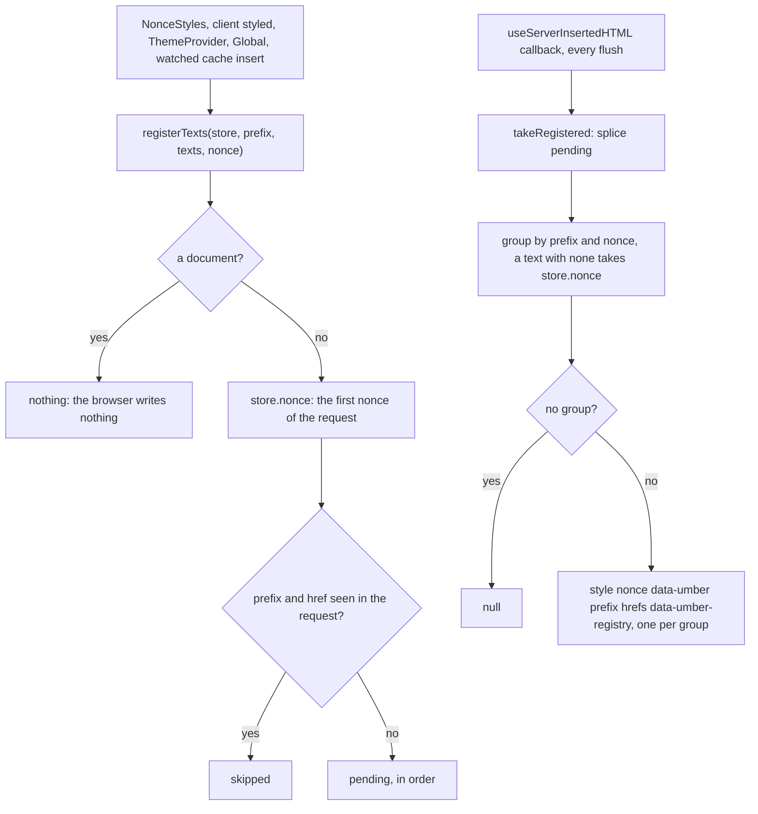

# styleRegistry.ts

Build: client. Imported by `next.tsx` (the `@umber-style/react/next` entry), by `NonceStyles.tsx` and by
the client build (`styled.ts`, `ThemeProvider.tsx`, `Global.ts`, `createStyle.ts`). It does not import
`next`: only `next.tsx` does.

## What it does

It holds the style registry of one request: the store, the context that carries it, and what reads and
writes it.

- `createRegistryStore()` makes the store of a request (`StyleRegistry` makes one with `useState`, so the
  server render of each request has its own, and the page in the browser has one that stays empty).
- `useStyleRegistry()` gives the store of the nearest `StyleRegistry`, or undefined; it reads the context
  only once `markRegistryRendered()` has been called in the program.
- `registerTexts(store, prefix, texts, nonce)` adds the texts the request has not registered yet. Only
  where there is no document: a server render.
- `takeRegistered(store)` takes what was registered since the last call, as the elements of one flush;
  `renderRegistered(store)` renders them, `null` when nothing is new.
- `watchCache(cache, store)` makes every new group of rules of a cache of `@umber-style/cache` a text of
  the store: the rules of the client components under the `CacheProvider` of a `StyleRegistry`.

## Why it exists

Next.js 16.4.6 gives React the nonce as the script nonce only, so the `<style data-precedence>` element
React merges the hoisted elements into has none, and the server components build sends its styles in
place instead (`NonceStyles`), where with JavaScript off they shift `:first-child`, `:nth-child` and `+`,
and a class first shown in a `Suspense` fallback had no rule for one frame when the content replaced it.
Next.js calls the callbacks of `useServerInsertedHTML` on every flush and writes their HTML before the
piece React has rendered: in the head for the first piece, at the top of the body before each later one.
The store is what those callbacks write: every text the request rendered since the last flush, so a rule
always comes before the first element that uses it, and is never among the elements of the page.

## The logic

## The data

- `StyleRegistryStore`: `seen` (`<prefix> <href>` of each text registered in the request), `pending` (the
  texts not written yet, each with its prefix, `href`, text and nonce), `nonce` (the first nonce a text of
  the request came with).
- A flush element: `<style nonce data-umber="<prefix> <href>..." data-umber-registry="">`, its text the
  texts joined, a string child, which React escapes as it escapes the text of every style element
  (`</style` cannot end it).
- The shared state `react.style-registry@1`: the context, made on first use, and `isRendered`.
- `watchedCaches`: a `WeakMap` from a cache to the store of the last registry that took it.

## What it guarantees

- Each text is written once in a request, in the order the request registered it, and before the piece of
  the stream that holds the element that registered it.
- `data-umber="<prefix> ..."` is the form the engine's cache in the browser reads as rules of the page
  (`createStyleSelector`), and `@umber-style/cache` as names it has: the browser writes none of them again.
  `data-umber-registry` tells the elements of this registry from those of a registry an app writes:
  `NonceStyles` and `keepRootRule` count only these.
- In the browser nothing is registered and the store stays empty; an app with no registry reads no context.
- The text comes from the engine (its caches, or the props of `NonceStyles`), never from the page.
- A cache's `insert` is wrapped once, however many registries take it, and calls the function it wraps.
- Nothing calls React when the module loads.

## Decisions

- A text that came with no nonce is written with the nonce of the request, when one of its texts came with
  one: a client component of a style with no nonce of its own, next to server components whose nonce comes
  from a source. A nonce the policy does not name refuses nothing more than no nonce does.
- One element for each prefix and nonce, rather than one for each text: one element for the whole first
  piece, as React's own merged element is.
- `seen` is by prefix and `href`: two engines may name a text alike (an animation name has no prefix).

## Limits

- The order of a request is the order its server render calls the components. A text registered by a
  render that React throws away is still written.
- With no `useServerInsertedHTML` (a set-up that is not the App Router) nothing takes the store, and nothing
  is written.
