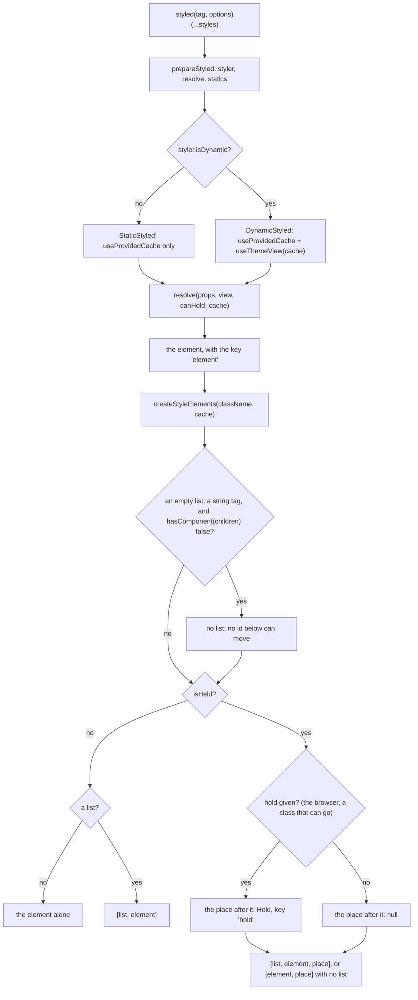

# styled.ts

Build: client. The server counterpart is `styled.server.ts`.

## What it does

`createStyled(engine, useThemeView, createStyleElements)` makes `styled`: `styled(tag, options)(...styles)`
and the tag shorthands (`styled.div`). The result is a component that computes its class from its props and
renders the element. Where the build sends style elements (a server render outside a cache provider), it
renders them as one list in front of the element; the browser renders an empty list there (one constant),
except in front of a tag with no component below it. An element whose `style` prop holds a plain object also has
a place after it: the browser's `Hold`, `null` on a server.

## Why it exists

It is the React side of the engine's `Styler`. `styledParts.ts` does what both builds share (the styler, the
element, the forwarded props); this file adds the hooks: the provided cache, the theme view, and the hold of a
class. `createStyle.ts` is the importer.

## The logic

## The data

`resolve` returns `{ element, forwarded, className, isHeld, hold }`. `isHeld` is whether `style` holds a plain
object, the same on a server and in the browser. `hold` is a function that returns a release function, stable
while the held class lives; undefined on a server, and for a class that stays for good.

`createStyleElements(className, cache)` returns the style elements of the class on a server, the frozen
empty list `NO_STYLE_ELEMENTS` in the browser (the same object each time), and `undefined` where the element
has no place for them: under a cache provider, or with `hasServerStyleElements: false` (`createStyle.ts`).

A component returns a list (an array), not a fragment element: React reads a fragment with no key at the
root of a component as its children, so both give the same tree, and the list is one array where a
fragment is an element, its props and a copy of its children at each render.

## What it guarantees

- A component with only object styles reads no theme context; it reads the cache context, which is free until
  a `CacheProvider` has rendered.
- `Hold` counts the element as a user of its class from the commit that shows it until the commit that drops
  it or the unmount, in an insertion effect. A render that is thrown away holds nothing.
- Only the browser holds: `canHold` is `typeof document !== 'undefined'`. A server render keeps every class,
  and renders `null` where the browser renders `Hold`.
- A server and the browser give the same ids of `useId`: React makes an id from the index of a child in a
  list and the length of the list (`pushTreeContext` in `react-dom/server`, `pushTreeFork` and `pushTreeId`
  in `react-dom/client`; a `null` child counts too), so both sides render lists of the same length with the
  element at the same index. The list of the style elements counts as one child however many elements it
  holds. The HTML of a server render is the same as before the places were added: the style elements come
  first, and the place after the element writes nothing (`useIdHydration.test.tsx`).
- The one exception is a string tag with no component below it (`hasComponent` of its children is false:
  text, nothing, lists of them, and elements of tags or of styled components of tags whose children are
  the same; a styled component calls no `useId` itself, and its `Hold` neither). With an empty list in
  front of it, which is the browser's and that of a server with no style element to send, the element is
  alone; a server that has some renders them in front of it. Only a component calls `useId`, and only the
  ids below the element depend on its place, so no id differs. Anything that `hasComponent` does not know
  (another component, a fragment, a portal, a promise, an iterable that is not an array) counts as a
  component.
- The element has the key `'element'` in every shape, and `Hold` the key `'hold'`: React asks for keys in a
  list it is given, and finds the element by its key when the list around it comes or goes (its children
  change from text to a component, its `Hold` comes or goes), so it keeps the element and its state.
- Under a cache provider, or without `hasServerStyleElements`, an element with no plain object in `style`
  is the element alone, on both sides.
- The returned component carries the statics (`_styles`, `_tag`, `_shouldForwardProp`, `_target`, `toString`),
  so styling it again flattens into one element.

## Decisions

- Two components (static, dynamic) so the hook list is fixed for each styled component.
- The tree is decided by what both sides know (the props, the cache provider above, the option), never by
  whether there is a document: whether a class is held (`hold`) and whether the server had style elements
  to send are known on one side only, so they fill a place and never add one. The exception is safe
  because nothing below such an element has an id: it is read from the children, which both sides have.
- The browser's place in front of the element is an empty list and not `null`: React reads a `null` in
  front of a child that it had at index 1 as a gap, and then matches the children through a new `Map` at
  every render (`reconcileChildrenArray` in `react-dom/client`). An empty list is a fragment with no
  children, which React skips when its props (the list) are the same object as before: one fiber, made once,
  and nothing allocated for the place at each render.
- Rejected: one array for every render, written over each time (no allocation for the list). It relies on
  React reading the list before it renders another component, which React does not promise.
- The style elements stay in front of the element: inside an `<svg>` React does not move them to the head,
  and the HTML keeps its order.
- The `style` prop is merged into the class (see `styledParts.md`), never rendered as an attribute.

## Limits

- A class made from a plain object in `style` is removed when no element uses it; each new value still writes
  a rule (comment on `StyleProp`).
- Outside a cache provider, with `hasServerStyleElements` on (the default), a styled element with a
  component below it (or whose tag is a component) returns a list of two children in the browser too, and
  has one more fiber, also in an app that is never rendered on a server.
- `hasComponent` reads the children at each render, down through the tags and the styled components below
  the element, until it meets a component: a large subtree of tags only is read again by every styled
  element above it.
- A render in which the list around the element comes or goes makes React match the children through a
  `Map` once; the element is kept by its key.
