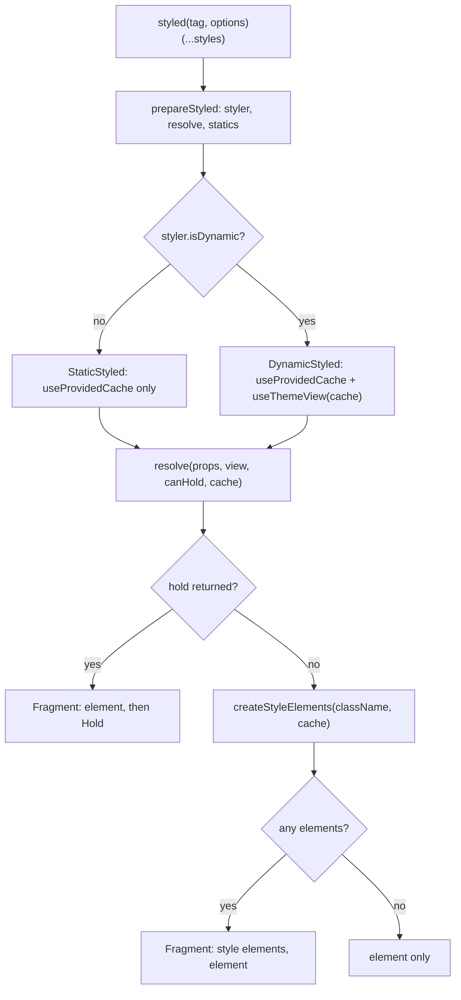

# styled.ts

Build: client. The server counterpart is `styled.server.ts`.

## What it does

`createStyled(engine, useThemeView, createStyleElements)` makes `styled`: `styled(tag, options)(...styles)`
and the tag shorthands (`styled.div`). The result is a component that computes its class from its props and
renders the element. Where the build sends style elements (a server render), it renders them in front of the
element. In the browser, an element whose `style` prop holds a plain object also renders a `Hold`.

## Why it exists

It is the React side of the engine's `Styler`. `styledParts.ts` does what both builds share (the styler, the
element, the forwarded props); this file adds the hooks: the provided cache, the theme view, and the hold of a
class. `createStyle.ts` is the importer.

## The logic

## The data

`resolve` returns `{ element, forwarded, className, hold }`. `hold` is a function that returns a release
function, stable while the held class lives.

## What it guarantees

- A component with only object styles reads no theme context; it reads the cache context, which is free until
  a `CacheProvider` has rendered.
- `Hold` counts the element as a user of its class from the commit that shows it until the commit that drops
  it or the unmount, in an insertion effect. A render that is thrown away holds nothing.
- Only the browser holds: `canHold` is `typeof document !== 'undefined'`. A server render keeps every class.
- The returned component carries the statics (`_styles`, `_tag`, `_shouldForwardProp`, `_target`, `toString`),
  so styling it again flattens into one element.

## Decisions

- Two components (static, dynamic) so the hook list is fixed for each styled component.
- The `style` prop is merged into the class (see `styledParts.md`), never rendered as an attribute.

## Limits

- A class made from a plain object in `style` is removed when no element uses it; each new value still writes
  a rule (comment on `StyleProp`).
