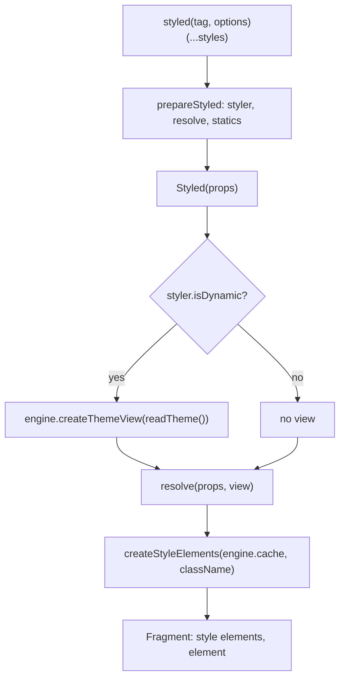

# styled.server.ts

Build: server (components build: no hook, no context). The client counterpart is `styled.ts`.

## What it does

`createStyled(engine, readTheme)` makes `styled` for server components. The component it returns resolves its
class from its props with `prepareStyled`, and renders the style elements of that class followed by the
element. A function style reads the view of `readTheme()`.

## Why it exists

A server component has no hook, so no theme context and no cache context. The theme comes from `readTheme` (the
base theme, else the theme of the first provider of the request, else an empty one), and the rules go to the
engine's own cache. `createStyle.server.ts` is the importer.

## The logic

## What it guarantees

- No hook, no context: `serverGuard.test.ts` checks it.
- Every element is sent with the `<style>` of its class; React sends each `href` once.
- Nothing is held or released: no `Hold`, and `resolve` is called without `canHold`.
- The statics are those of `styled.ts`, so a component of this build can be wrapped by `styled`.

## Decisions

- One component for static and dynamic styles; there is no hook order to protect.

## Limits

- No `CacheProvider`: the engine's cache is the only one.
