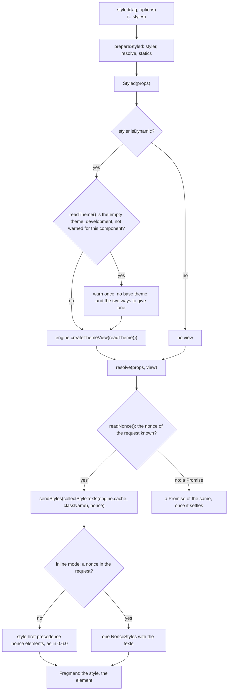

# styled.server.ts

Build: server (components build: no hook, no context). The client counterpart is `styled.ts`.

## What it does

`createStyled(engine, readTheme, readNonce, sendStyles)` makes `styled` for server components. The component
it returns resolves its class from its props with `prepareStyled`, and renders the style of that class
(`sendStyles` of the texts of `collectStyleTexts`, with the nonce of the request) followed by the element.
A function style reads the view of `readTheme()`.

## Why it exists

A server component has no hook, so no theme context and no cache context. The theme comes from `readTheme` (the
base theme, else the theme of the first provider of the request, else an empty one), and the rules go to the
engine's own cache. `createStyle.server.ts` is the importer.

## The logic

## What it guarantees

- No hook, no context: `serverGuard.test.ts` checks it.
- Every element is sent with the style of its class, with the nonce of the request (`readNonce`,
  `serverContext.ts`): the cache's, or what the source the app registered with `setNonceSource` gave for
  this request. Outside inline mode that is a `<style href precedence>` element for each text, which React
  sends once for each `href`; in a request with a nonce (from a source or the cache) it is one `NonceStyles`, which
  shows a text in place once in the request (`inlineStyles.server.ts`). While a source has not
  answered, the component returns a Promise of its element, which the render awaits.
- Nothing is held or released: no `Hold`, and `resolve` is called without `canHold`.
- The statics are those of `styled.ts`, so a component of this build can be wrapped by `styled`.
- In development, a component whose style function would read the empty theme (no base theme given, and no
  provider of the request has rendered yet) is warned about once, before the function runs, so the warning
  is printed before the error the function throws when it reads a token of the empty theme. It names the
  component (its `label`, its `name`, the tag, or the `displayName` or name of the component it wraps) and
  the ways to give a base theme: `createStyle(theme)` or `configure({ theme })` before the first `styled`
  call, or `getEngine().setTheme(theme)` when the theme is known only later. In production nothing is said.

## Decisions

- One component for static and dynamic styles; there is no hook order to protect.
- The warning is for the empty theme, not for the lack of a base theme alone: with no base theme, the theme
  of the first provider of the request gives the view its shape, and a style function works.

## Limits

- No `CacheProvider`: the engine's cache is the only one.
