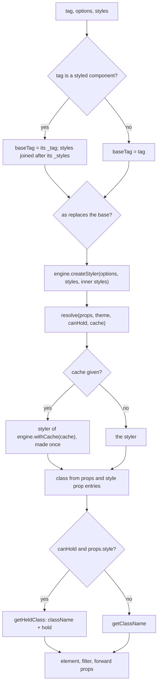

# styledParts.ts

Build: both (no hook, no context; the server guard lists it).

## What it does

`prepareStyled(engine, tag, options, styles)` does what both `styled` builds share. It makes the engine's
`Styler` for a component, and returns `{ styler, resolve, statics }`. `resolve(props, theme, canHold, cache)`
gives `{ element, forwarded, className, hold }` for one render: the element to render, the props that reach
it, the class, and the hold of a class made from the `style` prop.

## Why it exists

The client `styled.ts` and the server `styled.server.ts` differ in hooks and in how they send style elements,
and not in how a class and the forwarded props are decided. Keeping that in one file keeps the two builds
equal.

## The logic

## The data

- `StyledStatics`: `_styles`, `_tag`, `_shouldForwardProp`, `_target`, `toString` (a selector made by
  `createComponentSelector`).
- Stylers for other caches live in a `WeakMap` from an engine to a `Styler`, made on first use.

## What it guarantees

- `as` always replaces a string tag. For a component it replaces only when `shouldForwardProp('as')` is
  false (the comment in the file); otherwise the component gets `as` as a prop.
- `theme`, `className` and `style` are never forwarded; `as` is not when it replaces the element.
- The filter is: the one given; else, for a string tag, `isPropValid` of `@umber-style/is-prop-valid/react`
  (a tag with a hyphen forwards every prop); none for a component.
- Everything in `style` (entries, plain objects) and `className` joins the one class, after the styles. No
  `style` attribute is ever rendered.
- `target` classes of wrapped components and of this one are joined and added after the engine's classes.
- `forwarded.className` is `undefined` when empty.

## Decisions

- Wrapping a styled component flattens: the new component has the base tag and the styles of both.
- The styler over another cache is made lazily, for a component used under a `CacheProvider`.

## Limits

- A custom element receives every prop, valid or not (the hyphen rule).
