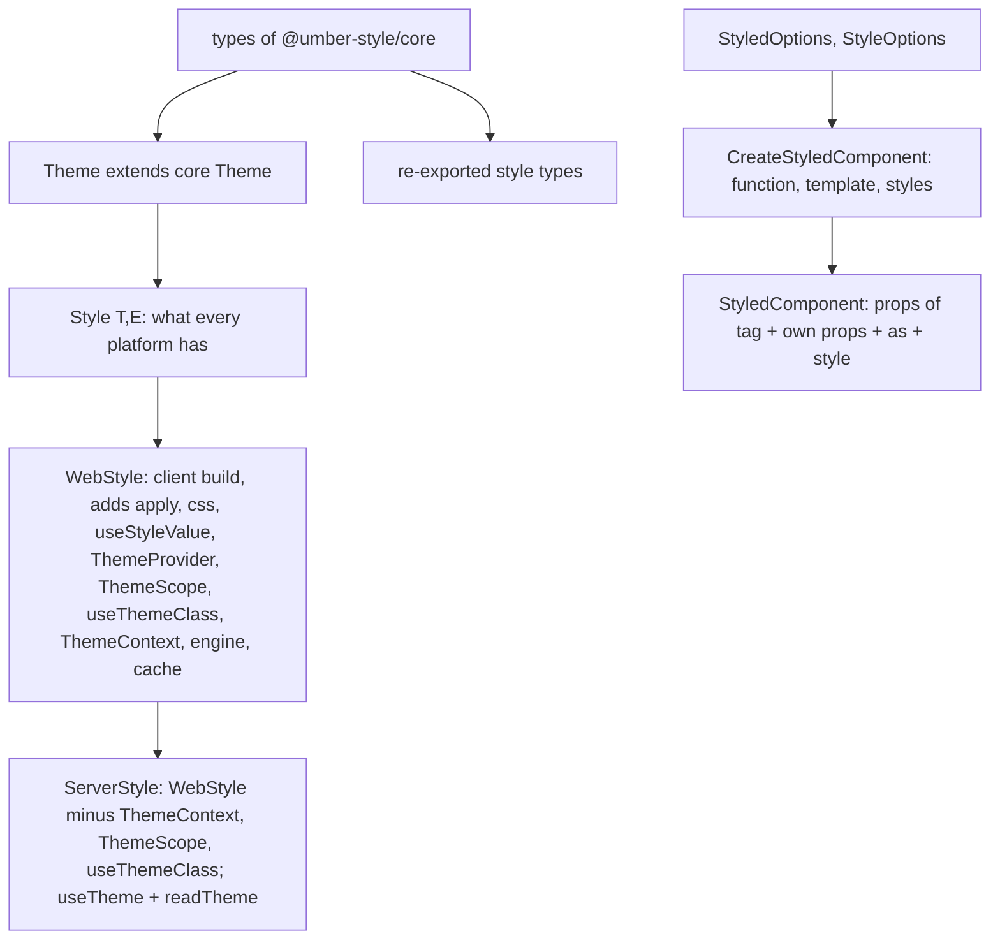

# types.ts

Build: both (types only; it has no runtime code).

## What it does

It holds the public types of the binding: the options (`StyleOptions`, `DefaultStyleOptions`,
`ServerStyleOptions`, `StyledOptions`), the theme (`Theme`), the styled component types (`Styled`,
`StyledComponent`, `CreateStyledComponent`, `StyledStatics`, `StyleProp`, `PropsOf`), the props of the
components (`ThemeProviderProps`, `WebThemeProviderProps`, `ThemeScopeProps`, `CacheProviderProps`,
`GlobalProps`), the setter of `useStyleValue` (`StyleValueSetter`), and the shape of a whole style (`Style`, `WebStyle`, `ServerStyle`). It re-exports the style
types of the core that an app annotates with, `StateName` and `StateKey` of the state keys among them.

## Why it exists

Every other file of the package types its API against these, and both entries re-export them
(`export * from './types'`). They are in one file so the client and server builds name the same types, and an
app augments one `Theme`.

## The logic

## The data

- `Theme` extends the core's `Theme`; an app augments it with `declare module '@umber-style/react'` or, for
  every binding, `'@umber-style/core'`.
- `StyleProp` takes sheet entries, style objects, React's `CSSProperties` (not with `isStrict`), arrays, and
  falsy values.
- `StyledComponent` removes from the tag's props the keys that the component's own props name, in a form
  chosen to cost the compiler less (the comment in the file explains the order of the tests).

## What it guarantees

- `ServerStyle` has no `ThemeContext`, `ThemeScope` or `useThemeClass`; `serverTypes.test.tsx` checks `useTheme`, `readTheme` and the missing
  `ThemeContext` on the value.
- The three overloads of `CreateStyledComponent` are in a fixed order: function, template, styles (comment in
  the file).
- A budget of type instantiations guards the cost of these types: `scripts/check-type-cost.mjs` (see its
  sidecar); the type tests are the `*.types.test.tsx` files beside this one.

## Decisions

- Props are not inferred from the values of a template: a styled component among them is a selector.
- `_Props` of `StyledOptions` changes nothing; it lets a wrapper name `StyledOptions<ComponentProps<C>>`.

## Limits

- The reason for each shape of conditional type is in the comments of the file; the code does not record
  more.
