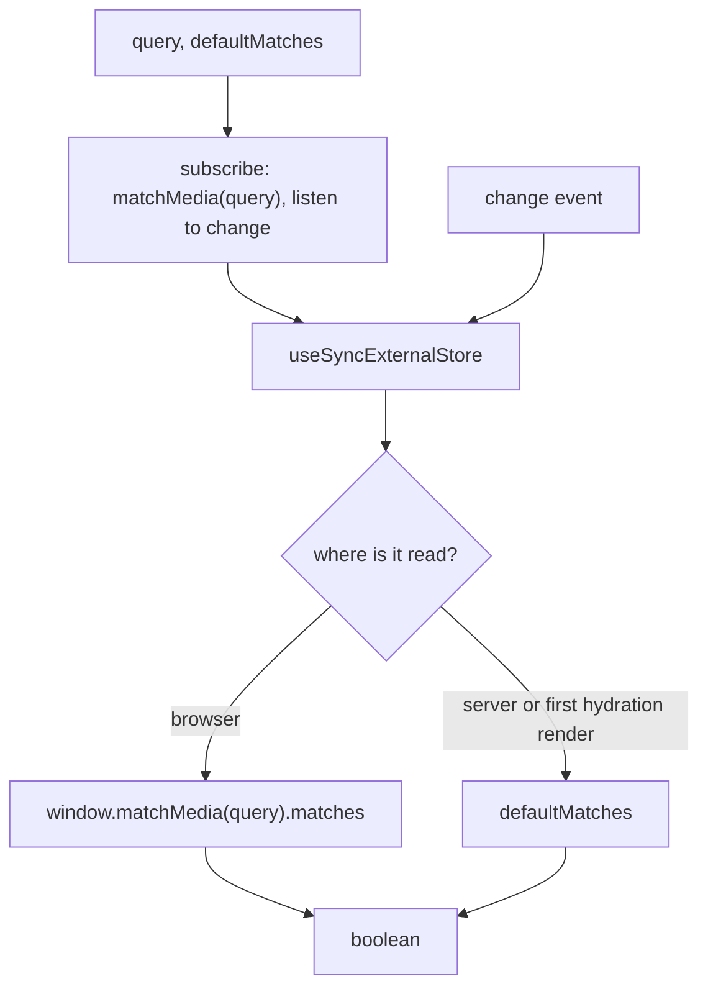

# useMediaQuery.ts

Build: client (`'use client'`). Not in the server build: it uses a hook.

## What it does

`useMediaQuery(query, { defaultMatches })` returns whether `window.matchMedia(query)` matches, and renders
the component again when the answer changes. On the server, and in the first render of a hydration, it
returns `defaultMatches` (false unless given).

## Why it exists

A style can answer a media query in CSS, but cannot choose to render one structure or another. This hook is
for that case. It is exported from `index.ts`.

## The logic

## What it guarantees

- The HTML of the server and the first hydration render agree (`defaultMatches`); the browser's answer follows
  at once (`useMediaQuery.test.tsx`, hydration case).
- It listens to the list of its query, and to the new list when the query changes; it removes the listener on
  cleanup.
- It renders again only when its answer changes.
- `window` is read only inside `subscribe` and the client snapshot, never at module top level.

## Decisions

- `useSyncExternalStore` with a server snapshot, so hydration needs no effect and no mismatch.

## Limits

- `subscribe` calls `window.matchMedia`; an environment with a window without `matchMedia` fails.
