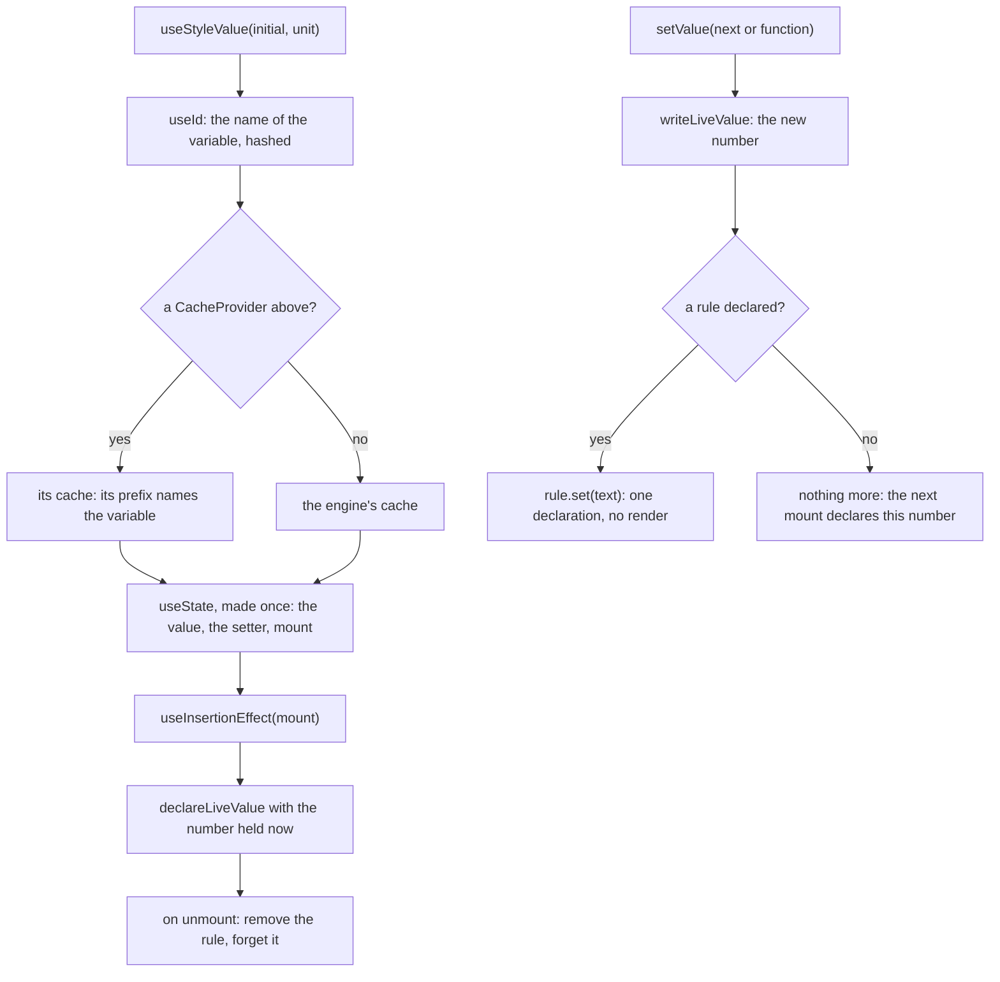

# useStyleValue.ts

Build: client (the server components build has `useStyleValue.server.ts`).

## What it does

`createUseStyleValue(readCache)` makes the hook `useStyleValue(initial, unit?)` of a style: it returns
`[value, setValue]`, as `useState` does. `value` is a value of `liveValue.ts` of the core (in a style, the
reference to a CSS variable of the component's own); `setValue(next)` and `setValue((previous) => next)`
change the declaration of that variable in place and render nothing. `createStyle.ts` gives each style one,
over the engine's cache.

## Why it exists

A number that changes on every frame, given as a plain object in `style`, makes a class for each number and
a render for each change. The hook writes the class once (it reads the variable) and turns each change into
one declaration set in the style sheet. The value, the rule and the unit are the core's; this file is the
React lifecycle around them.

## The logic

## The data

`ValueState`: `value` (the core's value), `set` (the setter) and `mount` (declares the rule, and returns
what removes it), made once for the component by `useState`, so the setter is the same function for the
life of the component. The variable is `--<prefix>-value-<hash of the useId>`.

## What it guarantees

- The setter never calls a state setter: the component renders once for any number of calls
  (`useStyleValue.test.tsx`, and in Chromium `useStyleValue.browser.test.tsx`).
- The class that reads the value does not change when the number does: the reference is fixed.
- The rule exists while the component is mounted, with the number it holds then; it is removed on unmount.
  Under strict mode the second mount declares it again with the number set in between.
- A server render and the browser give the variable the same name (`useId`), so hydration keeps the class.
- Under a `CacheProvider` the variable is named after its cache's prefix and declared in its cache's
  document.

## Decisions

- `useInsertionEffect`: the rule is there before layout effects and the browser's paint of the commit.
- The rule is declared at mount, not at the first call of the setter, so that a call never writes a rule.
- The first number is the fallback of the reference: a server render shows it, and needs no rule
  (`liveValue.md`).

## Limits

- The cache is read once, at the first render: a `CacheProvider` whose `value` changes later is not
  followed.
- Two roots of one page with the same `identifierPrefix` could name two variables alike.
- What renders from `value.get()` does not render again when the number changes: the value is not state.
