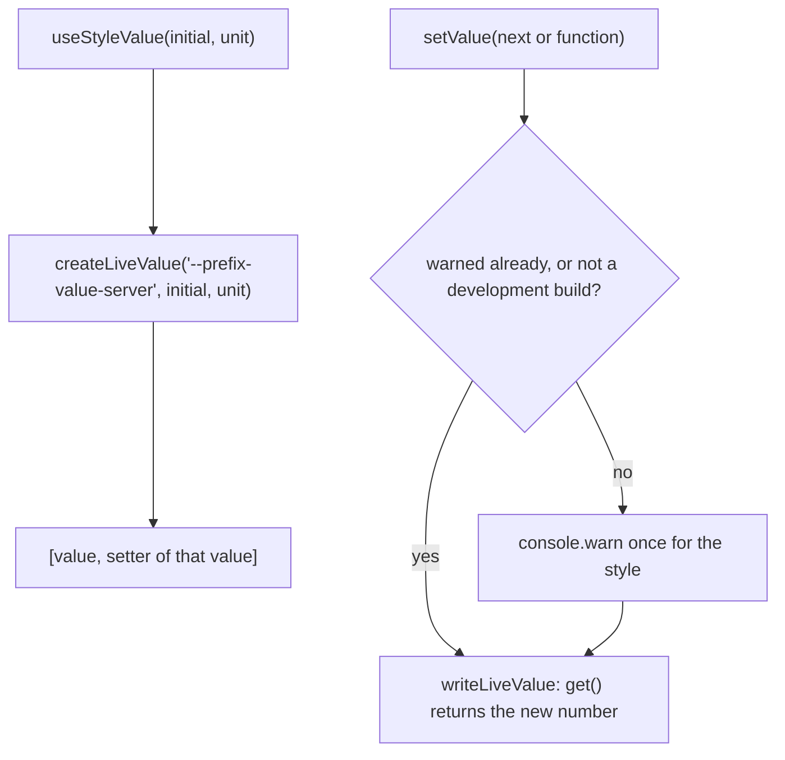

# useStyleValue.server.ts

Build: server (`createStyle.server.ts` gives each style one).

## What it does

`createServerStyleValue(cache)` makes `useStyleValue(initial, unit?)` for server components: it returns
`[value, setValue]` with the shape of the client build, where `value` is a value of the core whose variable
is `--<prefix>-value-server`, which nothing declares, so its fallback, the first number, is what a style
reads. `setValue` changes what `get()` returns, and warns once in development.

## Why it exists

A server component has no hook, no effect and never runs in the browser, so a value there cannot change on
the page. A component written for the client build can still be rendered in the server build: this gives it
the first number, with the class a client component would show at first, and says so when its setter is
called.

## The logic

## The data

One flag for the style, `hasWarned`. Every value of the build shares the one variable name: it is never
declared, so only the fallback of each reference counts.

## What it guarantees

- No hook is called, so the function works where React has none.
- The class of a server component that reads the value carries the first number
  (`useStyleValue.server.test.tsx`).
- One warning for the life of the style, only in development.

## Decisions

- A shared, never-declared variable rather than the number alone: the text of a style that reads the value
  has the same form in both builds, `var(--...-value-..., <first>)`.

## Limits

- A call of the setter changes nothing on the page.
- A server component cannot pass the value to a client component as a value: it is not plain data. A
  client component calls `useStyleValue` itself.
