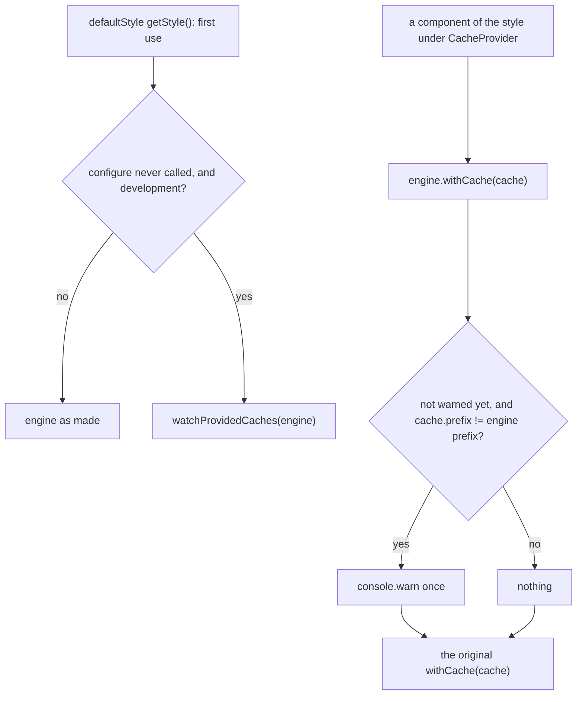

# watchProvidedCaches.ts

Build: client. The server build has no `CacheProvider`, so nothing there calls it.

## What it does

`watchProvidedCaches(engine)` replaces `engine.withCache` with a function that calls the one it replaced,
and, the first time it is given a cache whose prefix is not the engine's, prints one `console.warn`. The
text comes from `createUnconfiguredMessage(own, provided)`: the two prefixes, the two usual causes (a
`configure` call in a module dropped as side-effect-free, a `configure` call after the first `styled`
call), and what to do.

## Why it exists

An unconfigured default style works: it has the prefix `css` and every default option. So a `configure`
call that never ran (a library configured the engine from a module imported only for its side effect, and
the bundler dropped the import because the package says `"sideEffects": false`) fails silently in a built
site. One case can be told apart from a choice: the default style was never configured, and it renders
under a `CacheProvider` whose cache has another key. An app that means the defaults gives its cache the
key `css`, or no cache at all; an app that configured the style may give its cache any key (the cache
then names classes and variables, and the style's options still apply: `packages/server/src/cacheKey.test.tsx`).

## The logic

## The data

One flag, `hasWarned`, in the closure of each call: one warning for each default style, however many
components and caches render.

## What it guarantees

- What `withCache` returns is unchanged: the same engine over the cache, from the same function.
- Nothing is wrapped in production, nor for a style that `configure` was called on (any options, `{}`
  included): the check of the default style decides before it calls this.
- A cache of the engine's own prefix never warns.

## Decisions

- The engine's `withCache` is replaced on the engine the default style itself made, before the binding
  sees it: every component of the binding (styled components, `Global`, `ThemeProvider`, `useStyle`, the
  theme readers) reaches a provided cache through it, so one place covers them all. Wrapping each
  component, or a copy of the engine (`{ ...engine }`), was rejected: a copy reads the engine's getters
  once, and a wrapper changes the components an app holds.
- "Configured" means `configure` was called, not that an option differs from its default: an app that
  calls `configure({ theme })` and keeps the default prefix chose it.
- An engine given with `configure({ engine })` is configured, so it is never replaced.

## Limits

- A configure call that runs after the first use throws already (`defaultStyle.ts`); this warning is for
  the one that never runs, or runs only in another bundle (a chunk loaded later).
- An app that never configures and gives its cache a key of its own on purpose gets the warning in
  development. Give the cache the key `css`, or call `configure` with the prefix of the cache.
