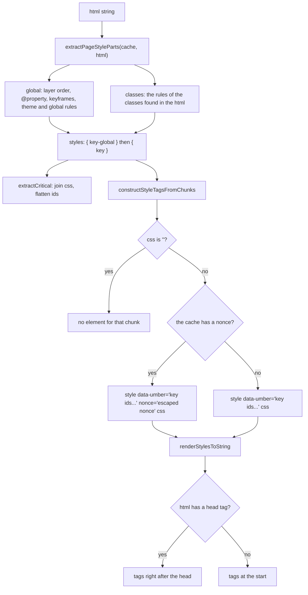

# createInstance.ts

## What it does

`createInstance(cache)` returns the server functions of one cache: `extractCriticalToChunks(html)` gives
the CSS a page needs in two chunks, `extractCritical(html)` gives it in one piece,
`constructStyleTagsFromChunks(chunks)` writes ``.
- `CriticalStyles`: `{ html, css, ids }`; `CriticalChunks`: `{ html, styles }`.

## What it guarantees

- The cache is not changed, so one cache can serve pages rendered at once; the same page gets the same
  CSS (test "gives the same output for the same page, and keeps two caches apart").
- The global chunk comes first, then the classes chunk.
- A chunk with no CSS gets no element.
- `html` is returned as given, in `extractCritical` and `extractCriticalToChunks`.
- No browser global is used.
- The named export `createInstance` is the default export, with the same type (the test "is the named
  export too, with the same type").

## Decisions

- The key of each chunk comes from `cache.prefix`.
- The nonce comes from the cache (`createCache({ key, nonce })` of `@umber-style/cache`), where a server
  that makes a cache for each request has the nonce of that request. It is escaped once, when the instance
  is made, by `createNonceAttribute` of the core, which `createStyleTag` and `extractPageStyles` use too,
  so every tag of a server is written the same way.
- The function is the default export and also a named one, the same function. A library that is an ES
  module package and ships a CommonJS build has its bundler compile `import createInstance from '@umber-style/server/create-instance'` as Node's
  interop does, where the default is the whole `module.exports` (`{ __esModule: true, default, createInstance }`),
  not the function, so it throws `is not a function`; `import { createInstance } from '@umber-style/server/create-instance'` gets the function.
  The shape of the CommonJS file (`cjsDefault: false` in `tsdown.config.ts`) was left as it is: making the
  function `module.exports` would change what every existing `require` of the entry gets.
  `scripts/smoke-packed.mjs` runs that interop on the packed tarball.
- The head is found with `/<head(?:\s[^>]*)?>/i`, so `<header>` is not a head; with no head, such as a
  fragment, the tags go at the start.

## Limits

- Only the first `<head ...>` is used, and the pattern does not understand a `>` inside an attribute
  value of the head tag. No test covers that.
- It extracts from the class names present in the HTML string; a class made after the HTML was built is
  not seen.
- The nonce is read once, when the instance is made: a cache whose `nonce` changed later (it is a read-only
  member, so only by a cast) keeps the first one here.
