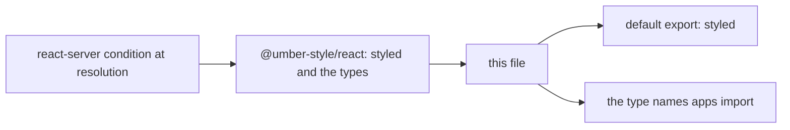

# index.ts

## What it does

Exports `styled` of `@umber-style/react` as the default export of `@umber-style/styled`, and re-exports the
types a styled component's code names (`CreateStyled`, `StyledComponent`, `StyledOptions`, `StyleProp`,
`Theme`, `CSSObject`, `Interpolation`, and the others in the file). It holds no code of its own.

## Why it exists

Code that imports `styled` as a default export (`import styled from '...'`) needs a module that has one.
The React binding exports `styled` by name only. This package is that legacy entry, so such code moves to
UmberStyle by changing its import path. Everything is the React binding's: no copy, no second engine.

## The logic

The default export is the very function `styled` of the React binding (the test "is the styled of the
default style of the React binding, with its types and shorthands"). `configure` of the binding sets its
engine, and a server component gets the server build because the `react-server` condition is applied when
`@umber-style/react` is resolved (`index.server.test.tsx`: "is the styled of the server build").

## What it guarantees

- Same function, same tag shorthands as own members (`styled.div`), same behaviour as the binding's.
- No module-level state of its own, no browser global.
- The types are the binding's, so a component typed through this entry is typed the same way.

## Decisions

- It re-exports instead of wrapping, so the server build and `configure` work without this package knowing
  about either.
- The type list is explicit, not `export *`, so the package exposes only the names apps import.

## Limits

- There is no named export and no other value: the package has one default export (`exports` has only
  `.`).
