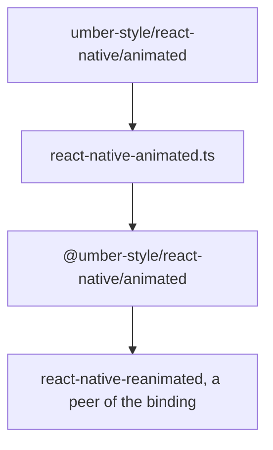

# react-native-animated.ts

## What it does

Re-exports the animated entry of React Native (`export * from '@umber-style/react-native/animated'`): the
value `animated` and the type `AnimatedDriver`. It is the file of the subpath `umber-style/react-native/animated`.

## Why it exists

The umbrella gives each binding as a subpath, and the animated entry of the React Native binding is an entry
of its own, which only an app with the animation library imports. It gets a subpath of its own here for the
same reason: `umber-style/react-native` must not load the library.

## The logic

## What it guarantees

- `animated` is the binding's value itself (`pnpm smoke:packed` compares them).
- No code of its own.

## Limits

- `umber-style/react` has no animated subpath: one style module for both platforms gets `animated` from a
  file of the app that the bundler picks for React Native (see `sharedCommon.md`).
