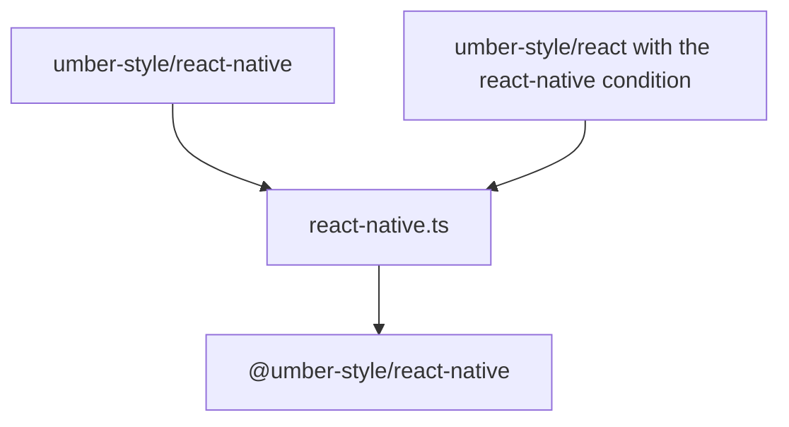

# react-native.ts

## What it does

Re-exports everything of `@umber-style/react-native` (`export * from '@umber-style/react-native'`). It is
the file of the subpath `umber-style/react-native`, and also the file that `umber-style/react` loads under
the `react-native` export condition.

## Why it exists

The umbrella gives each binding as a subpath, and shared code imports from `umber-style/react` so that
one source runs on the web and on React Native. For a bundler that sets the `react-native` condition,
the `exports` map sends that import here.

## The logic

## What it guarantees

- The names are those of the React Native binding, with the same identity.
- No code of its own, no browser global.

## Limits

- The `react-native` condition is not combined with `react-server` here: the React Native binding has no
  server build (the header of `shared.server.ts` says so).
