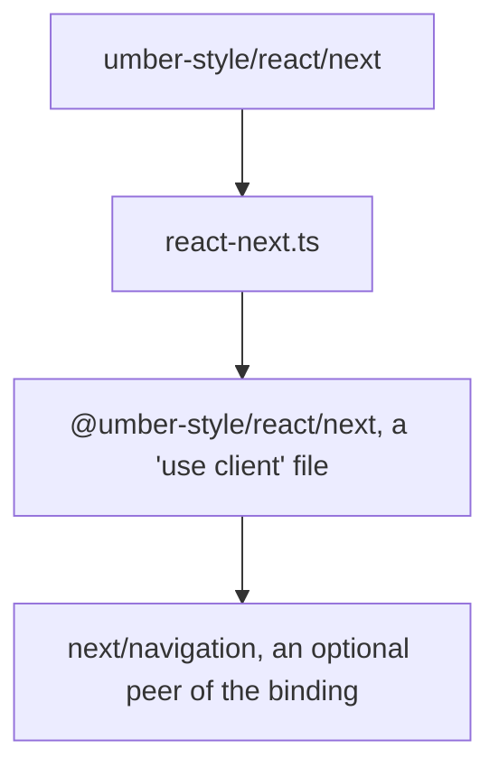

# react-next.ts

## What it does

Re-exports the Next.js entry of the React binding (`export * from '@umber-style/react/next'`): the
component `StyleRegistry` and the type `StyleRegistryProps`. It is the file of the subpath
`umber-style/react/next`.

## Why it exists

The umbrella gives each entry of a binding as a subpath, and the Next.js registry is an entry of its own
of `@umber-style/react`, the one file of the binding that imports `next`. It gets a subpath of its own here
for the same reason as `react-native/animated`: `umber-style/react` must not load `next`, which an app off
the App Router does not have.

## The logic

## What it guarantees

- `StyleRegistry` is the binding's component itself, and the only name of the entry
  (`reactNext.test.ts`; `pnpm smoke:packed` compares the packed files with `require`).
- No code of its own, and no `'use client'`: the binding's file has the directive, and a server
  component that imports this subpath gets the reference of the client component from it. The partial
  prerendering fixture (`fixtures/next-ppr`) imports the registry from this subpath in its root layouts.

## Decisions

- No `next` peer dependency here: the umbrella has none for the libraries of other entries either
  (`react-native-reanimated` of `react-native/animated`). The peer range is the binding's.
- No `react-server` condition: the registry is a client component, the same file in both builds.

## Limits

- Node loads the built file with `require` only, as the binding's own entry: `next` has no exports map, so
  an ES module cannot import `next/navigation` in Node. Inside Next.js its bundler resolves it.
