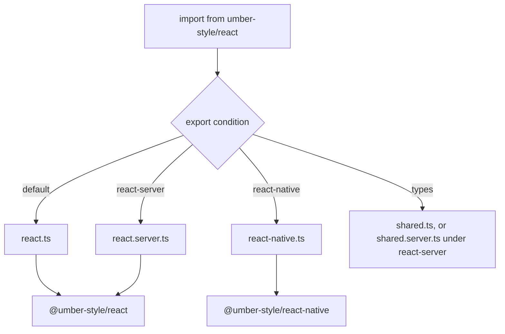

# react.ts

## What it does

Re-exports everything of `@umber-style/react` (`export * from '@umber-style/react'`). It is the file that
`umber-style/react` loads at run time on the web.

## Why it exists

The umbrella gives each binding as a subpath. The `react` subpath has four files that the `exports` map
of `package.json` picks between: this one (the `default` condition), `react-native.ts` (the
`react-native` condition), `react.server.ts` (the `react-server` condition) and, for the compiler, the
shared types of `shared.ts` and `shared.server.ts` under the `types` condition. One import path then
runs on the web and on React Native.

## The logic

## What it guarantees

- On the web this subpath is the React binding, unchanged (test "each binding exposes createStyle and the
  default style").
- No code of its own.

## Decisions

- The platform switch is in the `exports` map, not in code, so a bundler picks one file and the other
  platform's code is not loaded (test "the exports map points at files that exist, with the platform
  switch on /react").

## Limits

- The `react-native` binding and this one export different sets of names; the shared types (`shared.ts`)
  are the common part, and are what the compiler sees.
