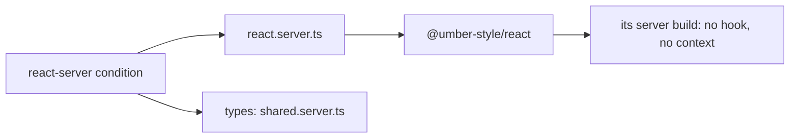

# react.server.ts

## What it does

Re-exports everything of `@umber-style/react` (`export * from '@umber-style/react'`). It is the file that
`umber-style/react` loads under the `react-server` export condition.

## Why it exists

The `exports` map needs a separate file for the `react-server` condition, because that condition also
swaps the `types` entry to `shared.server.ts`. The code is the same re-export as `react.ts`: the React
binding picks its own server build when it is resolved under that condition, so this file needs no logic
of its own (test "the react-server entry exposes createStyle too (it re-exports the package, which picks
its own build)").

## The logic

## What it guarantees

- Server components import the server build through the same `umber-style/react` path.
- The types the compiler sees are those of `shared.server.ts`, which has `readTheme` and no context.

## Limits

- Under this condition the React Native binding is not reachable: it has no server build.
