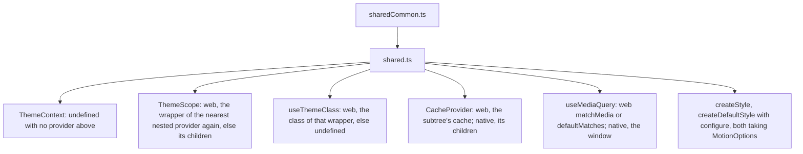

# shared.ts

## What it does

Declares the types of `umber-style/react` for the compiler under every condition except `react-server`:
the styling that runs on the web and on React Native. It re-exports `sharedCommon.ts` and adds what the
two client platforms have: `SharedStyle<T>` (the common styling plus `ThemeContext`, `ThemeScope` and
`useThemeClass`), `MediaQueryOptions`, and the declarations `ThemeContext`, `ThemeScope`, `useThemeClass`,
`CacheProvider`, `useMediaQuery`, `createStyle` and `createDefaultStyle`. Types and declarations only;
it is never loaded.

## Why it exists

At run time the entry is the web binding or the React Native binding, picked by an export condition. For
the compiler the `types` condition points here, so one source type-checks the same under both. The
server version is `shared.server.ts`. The tests `sharedTypes.test.tsx` and `sharedSource.test.tsx` use
it.

## The logic

## The data

- `MediaQueryOptions.defaultMatches`: the answer where it cannot be known yet (a server render on the
  web), default false.
- `SharedStyle<T>`: `SharedStyleBase<T>` with `ThemeContext: Context<T | undefined>`, `ThemeScope(props)` and
  `useThemeClass()`.

## What it guarantees

- A source typed against it compiles for the web and for React Native.
- No code is emitted.

## Decisions

- The platform differences are written in the doc comments of each declaration (what it does on the web,
  what on React Native) instead of two sets of types.

## Limits

- The declarations describe the behaviour of two bindings; nothing in this file checks that either one
  matches (the tests do).
