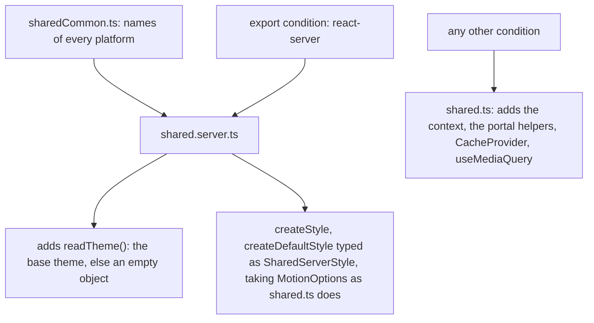

# shared.server.ts

## What it does

Declares the types of `umber-style/react` for the compiler under the `react-server` condition. It
re-exports `sharedCommon.ts`, adds `SharedServerStyle<T>` (the common styling plus `readTheme()`), and
declares `readTheme`, `createStyle` and `createDefaultStyle` for server components. It has types and
declarations only; it is never loaded.

## Why it exists

In a server component there is no context and no hook. At run time the entry is the server build of the
web binding, whose `useTheme` returns the base theme and which has `readTheme`, the same function. The
types must say so: no `ThemeContext`, no `ThemeScope`, no `useThemeClass`, no `CacheProvider`,
`useMediaQuery`. The `exports` map of `package.json` points the `types` condition at this file under
`react-server` and at `shared.ts` otherwise. `sharedServerTypes.test.tsx` checks it.

## The logic

## What it guarantees

- A shared source that type-checks here uses only what exists in a server component.
- `readTheme` and `useTheme` have the same type `() => T`.
- No code is emitted: the file holds `declare` statements and types.

## Decisions

- `readTheme` is typed here and not in `sharedCommon.ts` because the client build has no such name.
- The React Native binding has no `readTheme` and no server build, so code that must run on React Native
  uses `useTheme` (the header comment).

## Limits

- The declarations describe a build the file does not contain; the runtime and the types can drift apart,
  and only the tests catch it.
