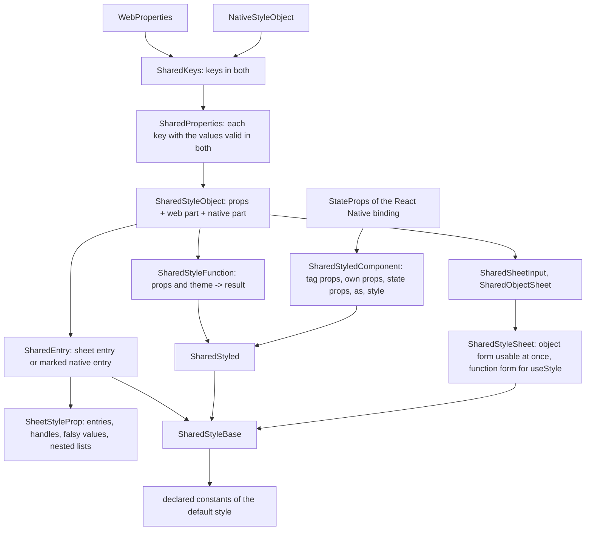

# sharedCommon.ts

## What it does

Declares the types that every build of `umber-style/react` shares: the style types that both the web and
React Native understand, the shapes of `styled`, `StyleSheet`, `css` and `apply` in shared code,
`SharedStyleBase<T>` (the styling of one theme shape that the web, React Native and server components
all have), and the declarations of the default style's functions (`styled`, `StyleSheet`, `useStyle`,
`useTheme`, `ThemeProvider`, `apply`, `css`, `themeClass`, `when`, `whenScheme`, `keyframes`,
`globalStyles`, `Global`, `configure`, `alpha`, `at`, `state`, and the arithmetic helpers `multiply`, `divide`,
`add`, `subtract`, `negate`). Types and declarations only; it is never loaded.

## Why it exists

`shared.ts` and `shared.server.ts` differ in a few members and agree on the rest. This file holds the rest
once, so the two cannot drift. It is imported by both (`export * from './sharedCommon'`).

## The logic

## The data

- `SharedStyleObject`: the keys valid on both platforms (a number, a percentage and `auto` are; `grid` and
  `10px` are not), plus `web` (merged over the rest on the web, dropped on native) and `native` (the
  other way round).
- `SharedEntry`: a class name on the web, a registered style object on React Native (`NativeSheetEntry`,
  with the mark of that binding); pass it on, do not read it.
- `SheetStyleProp`: what a `style` prop that takes sheet entries only takes in shared code (#89): a
  `SharedEntry`, a handle (`ThemedEntry`), `false`, `null`, `undefined` and nested lists; a plain object
  and a string are type errors. `SharedStyleProp` takes handles too.
- `SharedStyleSheet.create` given a function returns the definition and a handle for each name
  (`ThemedEntries<K, 'resolve' | 'prepare'>`, the own members of both platforms' sheets left out), and
  `useStyle` has an overload for it. `ThemedEntry` is exported with `SheetEntry`.
- `MotionOptions`: `{ animated? }`, the option of `createStyle` and `configure` that React Native reads
  (the `animated` of `umber-style/react-native/animated`) and the web accepts and ignores. The animation and
  transition keys are in both platform types (`NativeMotionStyle` of the React Native binding), so a shared
  style writes them in its shared part.
- `SharedStyledComponent` takes the state props `pressed`, `hovered` and `focused` (`StateProps` of the React
  Native binding), so shared code can tell a component its state; React Native reads them, the web does not
  (its selectors decide). `state(name)` is declared with the core's `StateName` and `StateKey`.
- `SharedPercent`: `` `${number}%` ``. The arithmetic helpers take numbers or percentages; `divide` by 0
  throws a `RangeError`; a token is a number on React Native and a `var(--x)` reference on the web, so the
  result there is a CSS `calc()`.

## What it guarantees

- A key appears in `SharedProperties` only if it is in both platform types, and its value type is the
  intersection of the two.
- No code is emitted.

## Decisions

- The sheet in object form carries `{ call?: never }`, so a function is not accepted by the object
  overload (the comment: the compiler tries the object form first).
- `css` puts the styles argument last in its overload list, so that a mistake in a style object is
  reported against a style.
- One style module for both platforms passes `animated` to the shared `createStyle`: the type takes it on
  every build, so the module type-checks once. The value comes from a file of the app that a bundler picks
  for each platform (`motion.native.ts` exports the entry's `animated`, `motion.ts` exports `undefined`),
  so the web never imports the animation library. Rejected: a web stub of the entry in the umbrella (logic
  in a package that only re-exports), and leaving the option off the shared type (the one module would need
  a cast or two calls).
- `useTheme` is common to all three builds; in a server component it returns the base theme and a
  `'use client'` component gets the nearest provider's values with the code unchanged.

## Limits

- The file declares; the implementations are in the bindings. Whether a declaration matches them is shown
  by `sharedSource.test.tsx`, `sharedStates.test.tsx`, `sharedTypes.test.tsx`, `sharedConditions.test.tsx` and
  `styleTypes.strict.test.tsx`.
