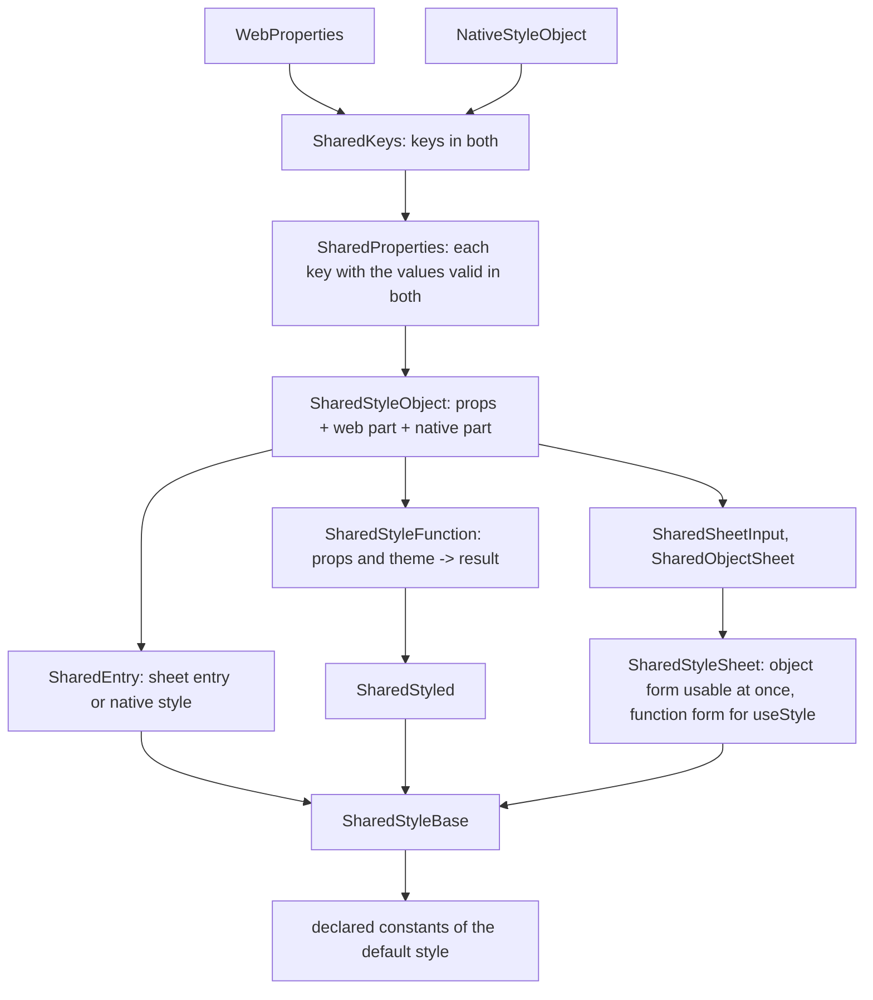

# sharedCommon.ts

## What it does

Declares the types that every build of `umber-style/react` shares: the style types that both the web and
React Native understand, the shapes of `styled`, `StyleSheet`, `css` and `apply` in shared code,
`SharedStyleBase<T>` (the styling of one theme shape that the web, React Native and server components
all have), and the declarations of the default style's functions (`styled`, `StyleSheet`, `useStyle`,
`useTheme`, `ThemeProvider`, `apply`, `css`, `themeClass`, `when`, `whenScheme`, `keyframes`,
`globalStyles`, `Global`, `configure`, `alpha`, `at`, and the arithmetic helpers `multiply`, `divide`,
`add`, `subtract`, `negate`). Types and declarations only; it is never loaded.

## Why it exists

`shared.ts` and `shared.server.ts` differ in a few members and agree on the rest. This file holds the rest
once, so the two cannot drift. It is imported by both (`export * from './sharedCommon'`).

## The logic

## The data

- `SharedStyleObject`: the keys valid on both platforms (a number, a percentage and `auto` are; `grid` and
  `10px` are not), plus `web` (merged over the rest on the web, dropped on native) and `native` (the
  other way round).
- `SharedEntry`: a class name on the web, a style object on React Native; pass it on, do not read it.
- `SharedPercent`: `` `${number}%` ``. The arithmetic helpers take numbers or percentages; `divide` by 0
  throws a `RangeError`; a token is a number on React Native and a `var(--x)` reference on the web, so the
  result there is a CSS `calc()`.

## What it guarantees

- A key appears in `SharedProperties` only if it is in both platform types, and its value type is the
  intersection of the two.
- No code is emitted.

## Decisions

- The sheet in object form carries `{ call?: never }`, so a function is not accepted by the object
  overload (the comment: the compiler tries the object form first).
- `css` puts the styles argument last in its overload list, so that a mistake in a style object is
  reported against a style.
- `useTheme` is common to all three builds; in a server component it returns the base theme and a
  `'use client'` component gets the nearest provider's values with the code unchanged.

## Limits

- The file declares; the implementations are in the bindings. Whether a declaration matches them is shown
  by `sharedSource.test.tsx`, `sharedTypes.test.tsx` and `styleTypes.strict.test.tsx`.
