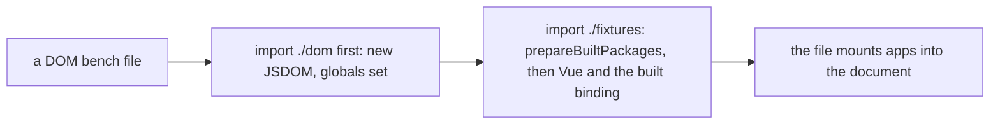

# dom.ts

## What it does

Makes a document of jsdom and puts `window`, `document`, its `MutationObserver`, its `Element` and its `SVGElement`
(which Vue's `mount` tests the container against) on `globalThis`, and exports the document. The Vue files that render into a DOM (`dom-trees.bench.ts`,
`dom-hydration.bench.ts`) import it first, before `fixtures.ts`.

## Why it exists

Vue's DOM runtime reads `document` when it loads, and `fixtures.ts` loads Vue as it is imported, so the
document must exist before that import is evaluated. The sandbox has no DOM of its own.

## The logic

## What it guarantees

- Vue finds a document when it starts, so `createApp(...).mount(...)` and hydration run against jsdom.

## Limits

- jsdom is not a browser: it computes no layout and paints nothing.
- It depends on the order of the imports of the file that uses it; a file that imports `fixtures.ts`
  first gets a Vue that saw no document.
