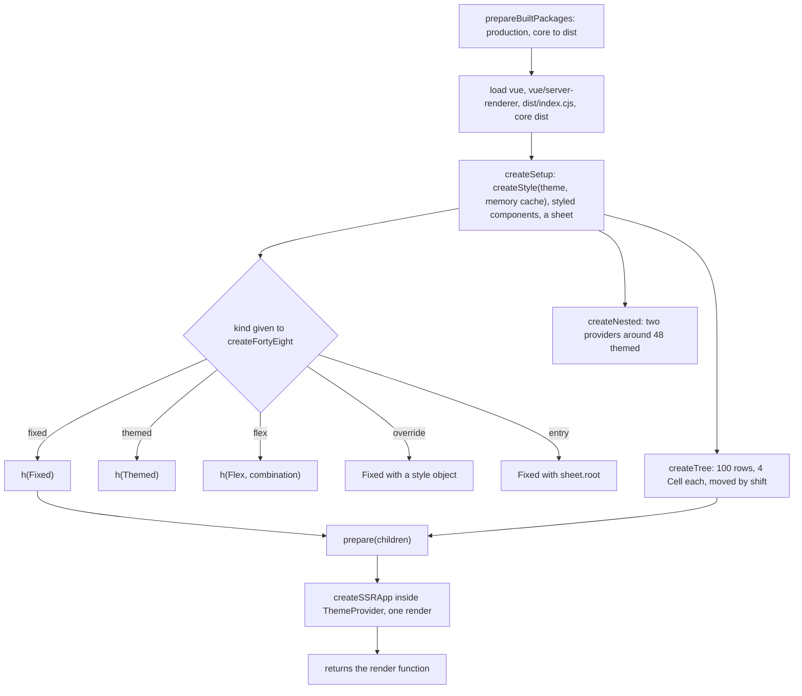

# fixtures.ts

## What it does

Makes the process run built code, then loads Vue, `vue/server-renderer`, the built binding
(`dist/index.cjs`) and the built core. It exports `createSetup()` (a fresh style object over an in-memory
cache and the components `Fixed`, `Themed`, `Flex`, `Cell` and a sheet), the type `Setup`,
`createFortyEight(setup, kind)`, `createTree(setup, shift)`, `createNested(setup)` and `prepare(children)`.

## Why it exists

The benchmark files `render-elements`, `render-trees`, `dom-trees` and `dom-hydration` measure the Vue
binding as an app loads it. The sandbox sets no `NODE_ENV` and the workspace link of the core points at
source, so `prepareBuiltPackages` runs first and Vue, the renderer and the binding load after it with
`createRequire` (`docs/benchmarks.md`). A static import would be resolved before the hook. The
components are made from the shared styles of `bench/src`, with this binding's `styled`.

## The logic

## The data

- 48 combinations of layout props. The tree has 500 styled elements: row `r` takes
  `combinations[(r + shift) % 48]`, cell `c` takes `TONES[(c + shift) % TONES.length]`.
- `createNested`: providers with `{ palette: { primary: '#d1531b' } }` and then
  `{ palette: { primary: '#123456' } }` around the themed elements; with the provider of `prepare`, three
  deep.
- The cache has prefix `b`, an in-memory sheet and no development checks.

## What it guarantees

- `prepare` awaits one render before it returns, so the operation measured is a render after the first.
- Each `createSetup()` has its own style object and cache.
- Nothing touches a browser global at module top level.

## Limits

- It renders to a string with the server renderer; the files that render into a DOM add their own setup
  in `dom.ts`.
- It needs `pnpm build` first.
