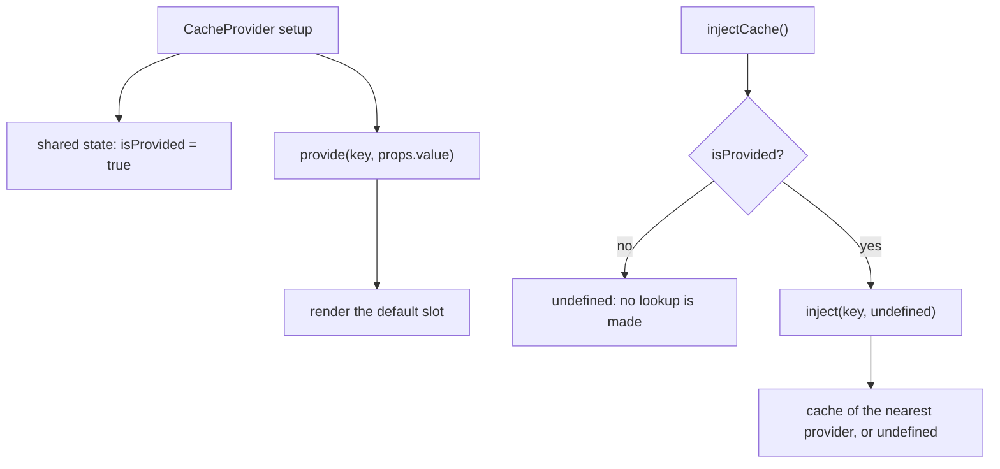

# CacheProvider.ts

## What it does

Exports the `CacheProvider` component and `injectCache()`. The component provides a `Cache` (the `value` prop)
to its slot; `injectCache()` returns the cache of the nearest provider, or `undefined` with none above.

## Why it exists

Server rendering and tests need every rule that a subtree writes to go to a cache of their choosing, not to the
engine's own. Components of the binding (`styled`, `useStyle`, `ThemeProvider`, `Global`) ask `injectCache()`
and, when they get a cache, work through the engine over that cache. `styled.ts`, `ThemeProvider.ts`,
`Global.ts` and `createStyle.ts` import `injectCache`; `index.ts` exports the component.

## The logic

## The data

One shared object, `{ key: InjectionKey<Cache>, isProvided: boolean }`, kept with `readSharedState` under
`vue.cache-provider@1`.

## What it guarantees

- An app with no `CacheProvider` never calls `inject` for the cache, so it pays nothing for the feature.
- Two copies of the binding share the key and the flag, so a component of one copy sees a provider of the
  other.
- `value` is read once, in `setup`: a different cache needs a new provider instance (a new `key`).
- The component renders only its slot and adds no element.

## Decisions

- `isProvided` is set by the first provider that is set up and is never reset. After that, every
  `injectCache()` call looks up the tree.
- The cache comes from `createCache` of `@umber-style/cache` or of the core (the prop comment names both).

## Limits

- `injectCache` must be called in `setup` or in a functional component (`inject` needs an instance).
