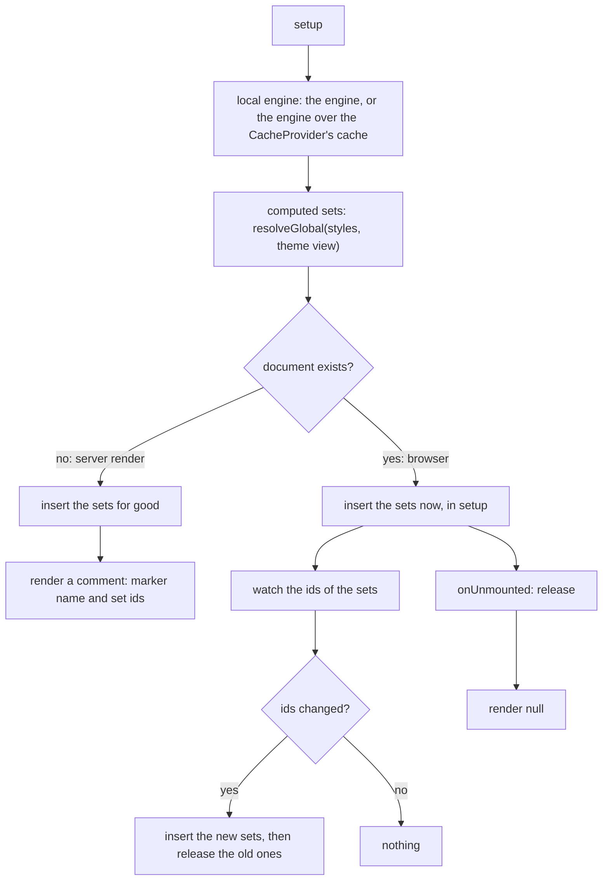

# Global.ts

## What it does

`createGlobal(engine, keys)` makes the `Global` component. It renders nothing visible and writes the rules of
its `styles` (a `globalStyles` handle, an object, a function of the theme, or a list of them) into the cache,
using the theme view of the nearest provider.

## Why it exists

Global rules (`body { margin: 0 }`, resets) belong to the page, not to an element. The component ties their
life to a place in the tree: written when it is set up, released when it unmounts, replaced when its input
changes. On a server it writes them for good and leaves a marker so that the CSS of one page holds them and
the CSS of another does not. `createStyle.ts` calls `createGlobal`; it uses `ThemeKeys` of `ThemeProvider.ts`
and `injectCache` of `CacheProvider.ts`.

## The logic

The view: with no cache provider, the injected view of the nearest provider, else a view of the base theme (or
an empty theme); under a cache provider, a view of the local engine over the injected real theme.

## The data

`GlobalRules` sets have an `id`. `insertSets` calls `engine.cache.insertGlobal(set, { isRendered: true })` for
each and returns one function that releases all. The server marker is the comment
`<!--<prefix>-global <ids>-->` (`createGlobalMarker`).

## What it guarantees

- In the browser the rules exist before the component mounts, and the new rules are written before the old
  are released, so there is no moment with neither.
- The cache counts the rules of each set, so equal styles in two components share them, and rules that a
  server render left in the page are taken over.
- On a server nothing unmounts: rules stay for `extractPageStyles`, and the comment marker names the sets.
- A hydration does not compare the text of a comment, so the marker causes no mismatch (the doc comment says so).
- It touches `document` only inside `setup` after a `typeof document` check.

## Decisions

- Write in `setup`, not in a mounted hook, so the rules exist before children render.
- A server render renders a comment because a component that renders nothing renders a comment in Vue.
- The marker is the way a page's CSS knows which global sets it holds; no marker is rendered when
  `createGlobalMarker` returns nothing (then the component renders `null`).

## Limits

- On a server the sets are computed once, in `setup`; a later change is not written.
