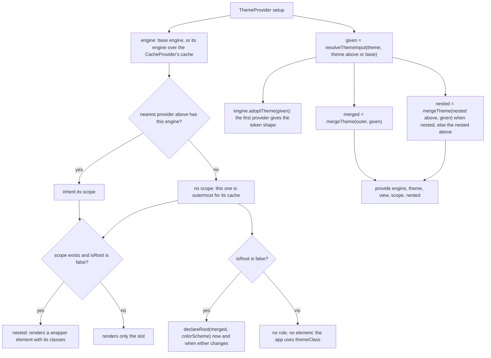

# ThemeProvider.ts

## What it does

Makes the three theme-related members of a style over one engine: the injection keys (`createThemeKeys`), the
`ThemeProvider` component (`createThemeProvider`), and `ThemeScope` with `useThemeClass` (`createThemeScope`).
A provider merges its theme over the one above and provides the real theme, its view, the scope wrapper and
the engine to the subtree.

## Why it exists

The theme decides CSS (variables on `:root` or on a wrapper element) and values for components. One provider
must do both and also work in nested, rooted and cache-scoped forms. The keys are made per style so that two
styles in one app do not read each other's providers. `createStyle.ts` builds all three and passes the keys to
`styled.ts` (through `useThemeView`) and `Global.ts`. `Global.ts` imports the `ThemeKeys` type.

## The logic

The wrapper's classes are the class of the theme as given, the class of `nested`, the themes of the nested
providers above it and its own merged (dropped when the first already starts with it, as it does directly
under the outermost provider), and the scope class (`display: contents`).

## The data

`ThemeKeys<T>` is five injection keys: `theme` and `view` (a `ComputedRef<T>` each), `scope`
(`ComputedRef<ThemeScopeValue | null>`, with `{ as, className }`), `nested` (`ComputedRef<T | undefined>`:
undefined under the outermost provider, read only from a provider of the same engine) and `engine`. `scope` is `null` under the
outermost provider and absent with no provider at all.

## What it guarantees

- The outermost provider renders no element; its theme is declared on `:root`, in `setup` and again when the
  merged theme or the color scheme changes.
- A nested provider renders its wrapper (`as`, default `div`) with the attributes of the component merged in
  (`inheritAttrs` is false, so the wrapper gets them once).
- With `isRoot` nothing is rendered or written.
- Whether a provider is outermost and the `isRoot` flag are read once, in `setup`.
- A provider of another engine (under a `CacheProvider` that changes the engine) starts its own scope and is
  outermost for its cache.
- `ThemeScope` renders the wrapper of the nearest nested provider again around its slot (for a teleport);
  with none it renders the slot alone. `useThemeClass` is the same class string, reactive.
- The theme a provider gives the engine through `adoptTheme` is not a base theme: code with no provider above
  never reads it (the comment says so).

## Decisions

- The view is a separate computed over the merged theme. The comment on `ThemeKeys` says the view is the same
  object while only the values of variables change; that is what `engine.createThemeView` gives.
- The wrapper carries the class of the nested themes merged as well, for use where it is not inside the
  wrappers above it. It leaves out the theme of the outermost provider, which is on `:root` or on the class
  of `<html>`, so a switch of that class reaches the tokens that no nested provider changes. The real theme
  (`theme`, `view`) is still the whole merged one.

## Limits

- `isNested` is fixed in `setup`: a later change of `isRoot` does not turn a nested provider into a rooted one.
- With `isRoot` and the class of the theme on an ancestor other than `<html>`, a provider in teleported
  content outside that ancestor does not see the root theme: neither `:root` nor its wrapper declares it.
