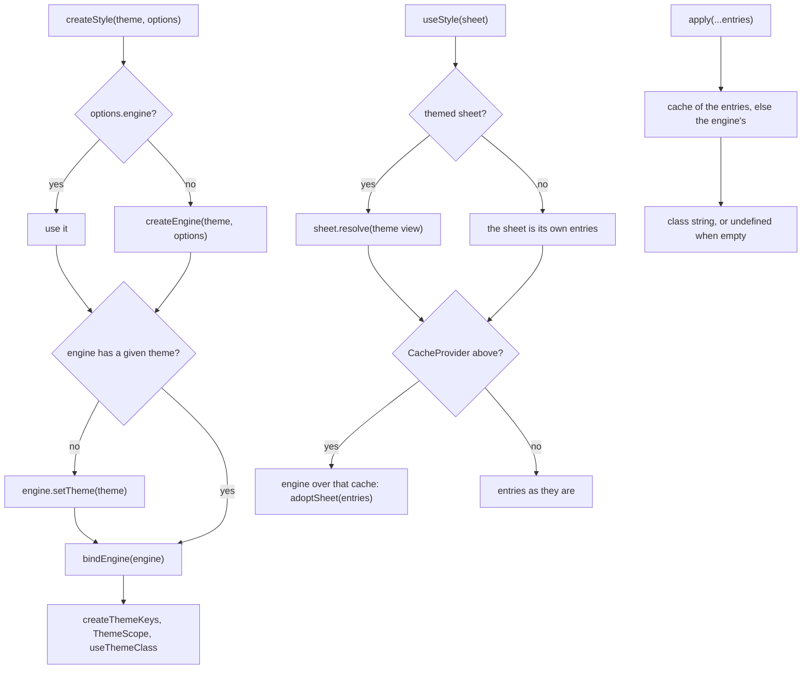

# createStyle.ts

## What it does

`bindEngine(engine)` builds the whole Vue styling of one engine and returns the `Style<T>` object: `engine`,
`cache`, `styled`, `StyleSheet`, `useStyle`, `apply`, `css`, `ThemeProvider`, `ThemeScope`, `useTheme`,
`useThemeClass`, `themeClass`, `when`, `whenScheme`, `keyframes`, `globalStyles` and `Global`.
`createStyle(theme, options)` makes an engine (or takes `options.engine`) and binds it.

## Why it exists

The default style (`defaultStyle.ts`) and an app's own style must be the same code. The engine knows no
framework, so this file connects it to Vue's injection and reactivity: the keys, the theme view, the cache
provider. It is a wiring file: most members are members of the engine, or of the files it calls
(`styled.ts`, `ThemeProvider.ts`, `Global.ts`). Importers: `defaultStyle.ts` (`bindEngine`) and `index.ts`.

## The logic

## The data

`readOwnTheme` is the theme where no provider is above: the base theme given on purpose, else the empty
theme, never one that a provider gave the engine. `useThemeView(cache?)` returns the injected view of the
nearest provider; under a cache provider it builds a view of the engine over that cache from the injected real
theme.

## What it guarantees

- `useTheme()` returns a `ComputedRef` of the injected theme, or of the base theme with no provider.
- An object sheet is returned by `useStyle` unchanged; a function sheet is resolved against the nearest
  provider's view. Both must be called in `setup`.
- Under a `CacheProvider`, entries are adopted into the engine over its cache, so what uses them writes there.
- `apply` makes its class in the cache of the entries (`findEntryCache`), so a class made under a cache
  provider is made in that cache.
- `css` makes a sheet entry from the engine's own cache; `themeClass`, `when`, `whenScheme`, `keyframes` are
  the engine's, and `globalStyles` the core's.

## Decisions

- `createStyle` sets the theme on the engine only when the engine has none given, so an engine passed in
  with its own base theme is kept.
- `create` is the engine's `createSheet`; the two overloads only type the object and function forms.
