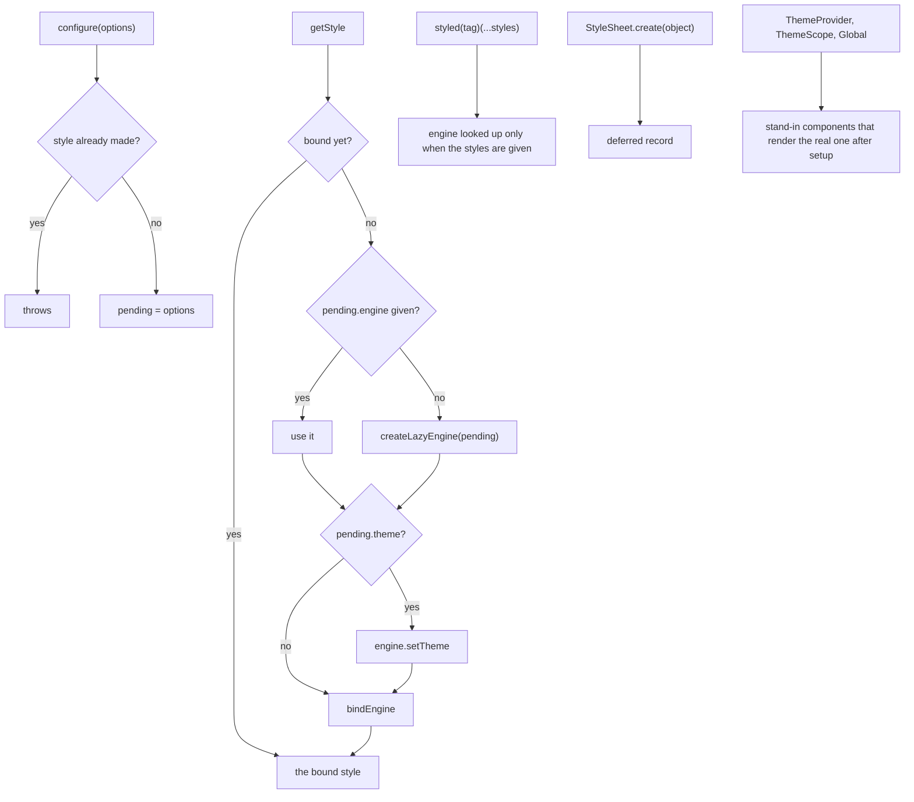

# defaultStyle.ts

## What it does

`createDefaultStyle()` returns the members that an app imports from the package root: `configure`,
`getEngine`, `styled`, `StyleSheet`, `useStyle`, `useStyleValue`, `useTheme`, `ThemeProvider`, `ThemeScope`, `useThemeClass`,
`apply`, `css`, `when`, `whenScheme`, `themeClass`, `keyframes`, `globalStyles` and `Global`. Each forwards to
a style that is made on first use.

## Why it exists

An app imports `styled` and calls `configure({ theme, prefix, ... })` after other modules may already have
created sheets and styled components. The engine can only be made once the options are known, so this file
makes it lazily and records `configure`'s options until then. `index.ts` is the only caller. The core
helpers `createLazyEngine`, `createDeferredRecord`, `createDeferredObject` and `withTagShorthands` carry the
laziness.

## The logic

## The data

`pending` holds the options of `configure` (`DefaultStyleOptions`: `BindingOptions<Theme>` plus an optional
`theme`); `bound` is the style once made.

## What it guarantees

- `configure` throws `configure must be called before the default style is used.` once the style is made.
- Reading `styled.div` and the other tag shorthands makes nothing; the engine is looked up only when the
  styles are given. So `Object.assign(wrapper, styled)`, which reads every tag, leaves `configure` open.
- An object sheet and a `css()` entry are deferred, so a module can create them before `configure`.
- `keyframes` and `globalStyles` need no engine and work before `configure`.
- `getEngine()` makes the style, and so ends the `configure` window.
- The stand-in `ThemeProvider`, `ThemeScope` and `Global` look up the real component in `setup`, so the engine
  exists by then; they pass attributes and slots through.

## Decisions

- Lazy binding rather than a required `configure` call: module load order belongs to the app.
- A function sheet (`StyleSheet.create(fn)`) is bound at once (it calls `getStyle()`), as is `useStyle`.
- `pending.engine` lets an app give an engine to share; otherwise a lazy engine is made from the options.
