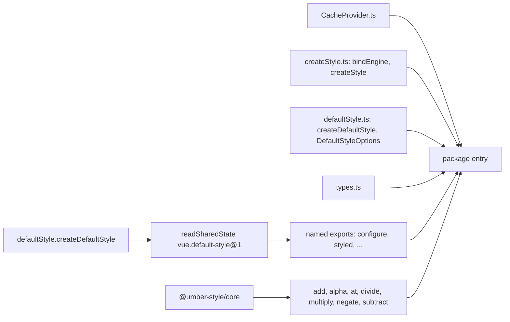

# index.ts

## What it does

The entry of `@umber-style/vue`. It makes the default style once, exports its members by name (`configure`,
`getEngine`, `styled`, `StyleSheet`, `useStyle`, `useStyleValue`, `useTheme`, `ThemeProvider`, `ThemeScope`, `useThemeClass`,
`apply`, `css`, `themeClass`, `when`, `whenScheme`, `keyframes`, `globalStyles`, `Global`), and re-exports the
rest of the public API.

## Why it exists

The package's public API is this one file. The default style is taken with `readSharedState` under the name
`vue.default-style@1`, so two copies of the binding in one program share one default style, and a component of
one copy reads the provider of the other (the comment says so). The umbrella package re-exports it as
`umber-style/vue`.

## The logic

## What it guarantees

- One default style for the whole program, however many copies are loaded.
- Making it touches no engine: `createDefaultStyle` is lazy.
- `export *` adds only what `createStyle.ts`, `defaultStyle.ts` and `types.ts` export.

## Decisions

- The helpers `add`, `alpha`, `at`, `divide`, `multiply`, `negate`, `subtract` are the core's, not the
  binding's. The React Native entry has its own `alpha` and calc helpers; the reason is not recorded here.
