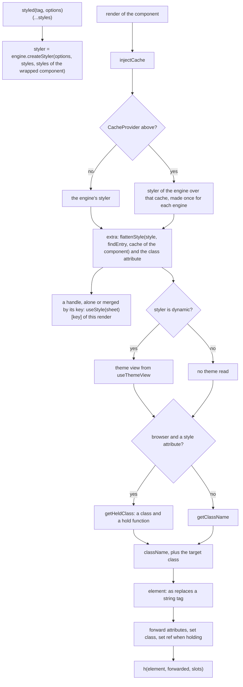

# styled.ts

## What it does

`createStyled(engine, useThemeView)` returns `styled` for Vue, with the tag shorthands (`styled.div`).
`styled(tag, options)(...styles)` makes a functional component that renders the tag, or another component,
with one class that the engine builds from the styles, the `style` attribute and the `class` attribute.

## Why it exists

A styled component must turn styles into one class, keep working when it is wrapped, work under a
`CacheProvider`, and in the browser let a class go when no element uses it any more. The engine builds
classes (`createStyler`); this file adapts that to Vue's rendering: attributes, slots, refs. `createStyle.ts`
is the only importer.

## The logic

## The data

A styled component is a function with static members (`StyledStatics`): `_styles` (every style, those of a
wrapped component first), `_tag`, `_shouldForwardProp`, `_target` and `toString`, the component as a
selector (`${Button}:hover &`). Styling a styled component again flattens into one element: the inner
component's tag and styles are used, not nested.

## What it guarantees

- Everything in the `style` attribute (entries and plain objects) joins the one class, after the styles; no
  `style` attribute is ever rendered. A string in `style` is an error (the comment in the code says so; the
  check is in the core's `flattenStyle`, which this file does not show).
- `flattenStyle` is given the cache the component writes to: a handle of a sheet made from a function of
  the theme is resolved with the theme of the render, alone or merged by Vue into one object, where it is
  found again by its key (`findEntry` is given, so nothing is taken for what a server component passed:
  `sheetEntry.md`).
- `as`, `theme`, `class` and `style` are never forwarded to a tag; other attributes go through
  `shouldForwardProp` when the element is a string. For a component that is not made by `styled`,
  `as` is forwarded and every attribute is.
- A `target` class is added after the engine's classes, and the wrapper keeps the wrapped one's.
- In the browser an element given a plain object in `style` holds that class (`ref` with a release function)
  so the class is removed when no element uses it; a server render keeps every class.
- `inheritAttrs` is false: attributes are forwarded once, by hand.

## Decisions

- Functional component, with the engine's styler doing the work: nothing is cached in the component.
- A styler for another cache is made on first use, by engine, in a `WeakMap`.
- The held class is released after the new one is held (`createHoldRef`), so an element never has none.

## Limits

- Holding applies only when there is a `style` attribute; a class from fixed styles is never released.
