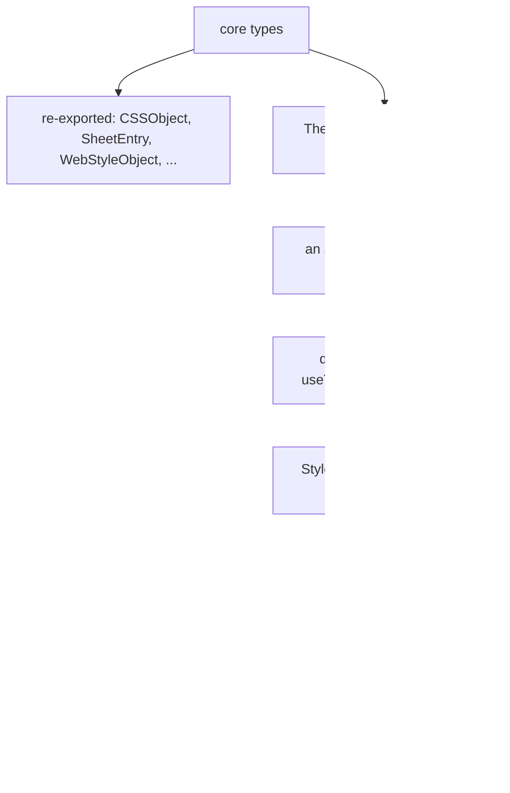

# types.ts

## What it does

Types only: the public types of the Vue binding. The main one is `Style<T>`, what `createStyle` and
`bindEngine` return. It also holds `Theme` (the default style's theme, augmentable), the options
(`StyleOptions`, `StyledOptions`, `FilteringStyledOptions`), the `styled` types (`Styled`, `StyledFactory`,
`StyledTags`, `StyledComponent`, `StyledStatics`, `CreateStyled`), the style props (`StyleProp`,
`SheetStyleProp`), `CssFunction`, `Sheet`, and the props of
`ThemeProvider` and `Global`. It re-exports many style types of the core, `StateName` and `StateKey` of the state keys among them.

## Why it exists

An app annotates with these types and augments `Theme` so `styled`, `useTheme` and `ThemeProvider` of the
default style are typed. The core types are re-exported so an app imports them from `@umber-style/vue`
alone. Importers: `createStyle.ts`, `defaultStyle.ts`, `styled.ts`, and `index.ts` (`export *`).

## The logic

## The data

- `Theme` extends the core's `Theme` and has an optional `_theme?: never` member only so it is not empty. An
  app augments `@umber-style/vue` for Vue alone, or `@umber-style/core` for a theme every binding shares.
- `StyledFactory<T>` has three call forms in a fixed order: a function style, a template, then styles
  (styles last, so a mistake in a style object is reported against a style).
- `PropsOf<C>` is the props of an intrinsic element, of a component with `$props`, or of a functional
  component.
- `Style<T>.useStyle` has three overloads: an object sheet returns itself, a sheet made from a function
  (`Sheet & ThemedEntries<K>`) is resolved, and the general `Sheet<S>`.
- `StyleProp` is what the style attribute of a styled component takes: entries, handles, plain style
  objects, falsy values and nested lists. `SheetStyleProp` takes entries only (#89): an entry, a handle,
  `false`, `null`, `undefined` and nested lists; a plain object and a string are type errors. Both are
  new in 0.9.0.
- `StyleSheet.create` given a function returns `Sheet & ThemedEntries<K>`: a handle for each name.
- `Style<T>.useStyleValue` returns a `StyleValueRef`: the core's `LiveValue` with a `value` of a ref's shape.

## What it guarantees

- A styled component takes any attribute (`FunctionalComponent<Record<string, unknown>>`).
- `StyledStatics._styles` and `_tag` are what lets a styled component be flattened when styled again.
- `Sheet.resolve` is the only run-time member of a sheet made from a function.
- No run-time code is in the file: importing it adds nothing to a bundle.

## Decisions

- `FilteringStyledOptions` only types the guard of `shouldForwardProp`, since a Vue styled component takes any
  attribute (the comment says so).
- `useThemeClass` and `useTheme` return `ComputedRef`s, called in `setup`.

## Limits

- `Theme` must be augmented by the app; the file does not know the app's tokens.
- The style attribute of a styled component is still untyped (`Record<string, unknown>`): typing it as
  `StyleProp` makes three existing tests fail to compile (they pass a value typed `unknown` or `object`, and
  a string to check the error), so that change waits for a decision.
