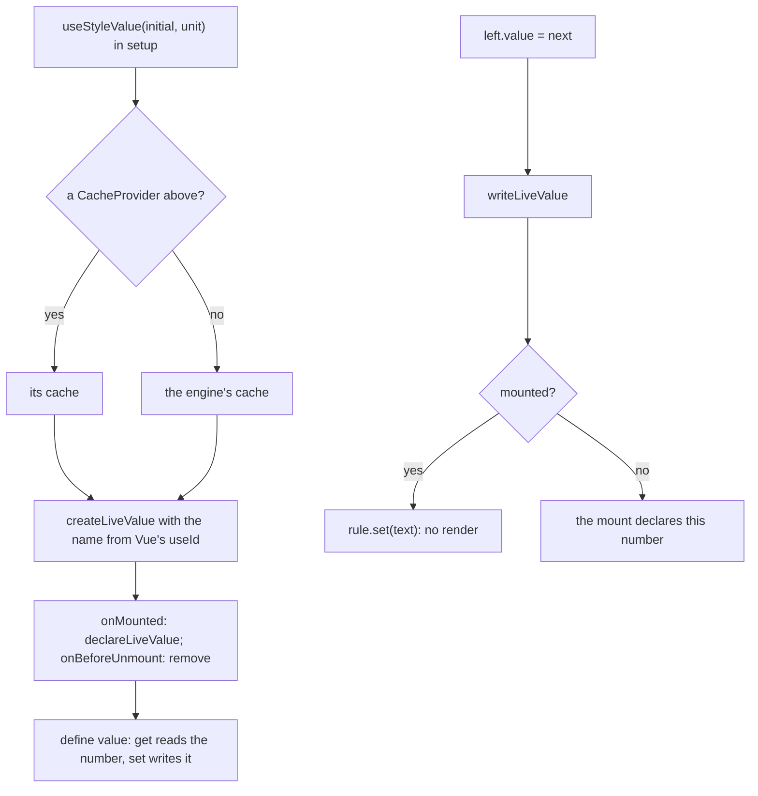

# useStyleValue.ts

## What it does

`createUseStyleValue(readCache)` makes `useStyleValue(initial, unit?)` of a Vue style, called in `setup`. It
returns a value of `liveValue.ts` of the core (in a style, the reference to a CSS variable of the
component's own) with `value` in the shape of a ref: reading it gives the number, setting it changes the
declaration of the variable in place, with no render. `createStyle.ts` gives each style one, over the
engine's cache.

## Why it exists

The same need as the React hook (a number that changes on every frame, with one class and no render), in
the form Vue code expects: a ref is read and set through `value`.

## The logic

## The data

The value of the core, with an own accessor `value` that is not enumerable (it is not listed by
`Object.keys`, as no method is). The variable is `--<prefix>-value-<hash of the useId>`.

## What it guarantees

- Setting `value` renders nothing (`useStyleValue.test.ts`: 300 changes, one render, the same class).
- A number set in `setup`, before the mount, is the one the rule declares.
- The rule is removed before the component unmounts.
- A server render and the hydration give the variable the same name (Vue's `useId`).

## Decisions

- `value` is an accessor of each value, so that setting it reaches the rule of that component: the
  accessor is the one per-value function, where `get` and `toString` stay on the shared prototype.
- Not a ref of Vue (no `__v_isRef`): a template would unwrap it to the number, and a style would lose the
  reference.

## Limits

- The value is not reactive: a render that reads `left.value` is not run again when it changes.
- The cache is read once, in `setup`.
