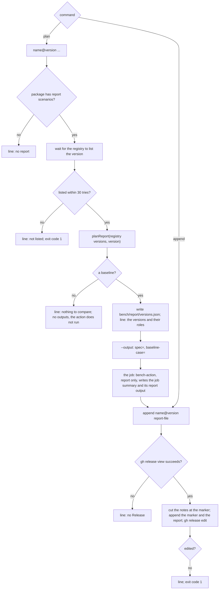

# bench-report.mjs

## What it does

The parts of the benchmark report after a release that `soroush-tech/bench-action` does not do. The
`bench-report` job of `.github/workflows/cd-packages.yml` runs it twice, around the action:

- `node scripts/bench-report.mjs plan <name>@<version> ... [--summary <file>] [--output <file>]`, before
  the action. For each `name@version` given:
  1. A package with no report scenarios (all but `@umber-style/core`: `SCENARIOS`) gets a line that says so.
  2. It waits until the npm registry lists the version: 30 tries, 10 seconds apart. When it never does, the
     package gets a line that says so and the run will exit 1.
  3. `planReport` (`bench/src/releases.ts`) picks the versions to compare from the registry's list: the
     last stable, and for a prerelease the previous release of its channel for the same version, and the
     baseline among them. With nothing to compare (a first release) the package gets a line that says so,
     and nothing else.
  4. It writes the versions, oldest first and the published one last, into `bench/report/versions.json`,
     prints a line that names each with its role, and with `--output` writes `spec=<name>@<version>` and
     `baseline-case=<baseline>` (the step's outputs, which the job gives the action).
- `node scripts/bench-report.mjs append <name>@<version> <report file> [--summary <file>]`, after the
  action: it puts the report file (the action's `report` output, which the job writes to a file) below the
  notes of the GitHub Release `<name>@<version>`, in place of a report a run before put there.

`--summary` appends the lines the script printed to that file (the job summary). Exit code 0 on success; 1
when the registry never listed a version that has scenarios, when the Release could not be edited, or on a
command it does not know.

## Why it exists

The owner asked for a report after each release that says how the published version compares with the
last stable (and a prerelease with the previous one of its channel), with every version installed from npm
the same way. bench-action 1.3.0 runs the files and lays out the report, ratios included, with no gate; the
repository keeps the rules it alone knows: which versions, when npm has them, the file the bench files read,
and where the report goes after the notes of a Release.

## The logic

## The data

- `versions.json`: `{ "package": "@umber-style/core", "versions": ["0.1.0", "0.2.0-alpha.0", "0.2.0-alpha.1"] }`,
  oldest first, the published version last. Each version is a case of every report file, keyed by the
  version (`bench/report/support.ts`), so the baseline case is a version.
- The outputs: `spec=@umber-style/core@0.2.0-alpha.1` and `baseline-case=0.1.0`.
- The marker `<!-- umber-style benchmark report -->` separates the notes of a Release from the report.

## What it guarantees

- No ratio and no time is worked out here: they are soroush-bench's, through the action.
- A rerun replaces the report in a Release; the notes above the marker are kept as they are, and
  `release-notes/<version>.md` is not touched.
- Only a package with scenarios, listed by the registry and with something to compare, gets outputs, so
  the action never runs on a file without versions.

## Decisions

- **The action runs the files, not this script.** Until bench-action 1.3.0 it refused a `min-ratio` that is
  not above 0, so the script ran the soroush-bench CLI with `--json-file` and divided the ratios itself
  (`bench/src/reportTable.ts`, now removed). 1.3.0 reports without a gate when `min-ratio` is empty, takes
  the ratios from soroush-bench 2.4.0 (`ratioPct` with `--baseline-case` alone), writes the job summary
  with no pull request, and names the bench version, Node version and sandbox limits of the run.
- **The layout is the action's**: a summary table across the files and each file's table folded under it.
  The roles of the versions (last stable, previous of the channel) are not in it, so `plan` prints them in
  a line of the job summary.
- **Two commands in one file**, so that the scenarios, the marker and the registry wait stay in one place.
- **The Release is edited here, not in the workflow**, so that the marker and the replace on a rerun are in
  one place.
- **Only the core has scenarios.** The gate scenarios are the core's; no binding has a gate-style scenario
  (the binding files compare cases within one build, and load React or Vue from the workspace). The job
  runs the action once, on `bench/report/`.

## Limits

- It needs the network and, for `append`, `gh` and a token that may edit Releases.
- A report made long after a release compares with what the registry lists then, filtered by version
  order (`planReport` takes only older versions).
- It has no test of its own; the choice of versions is tested in `bench/src/releases.test.ts`.
- The job runs the action once: a second package with scenarios would need a second action step.
