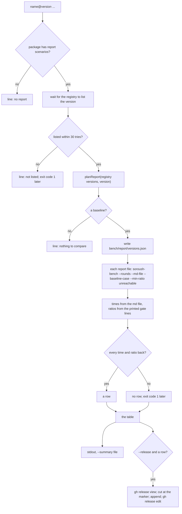

# bench-report.mjs

## What it does

`node scripts/bench-report.mjs <name>@<version> ... [--rounds <n>] [--summary <file>] [--release]` makes
the benchmark report after a release. For each `name@version` given:

1. A package with no report scenarios (all but `@umber-style/core`: `SCENARIOS`) gets a line that says so.
2. It waits until the npm registry lists the version: 30 tries, 10 seconds apart. When it never does, the
   package gets a line that says so and the run will exit 1.
3. `planReport` (`bench/src/releases.ts`) picks the versions to compare from the registry's list: the
   last stable, and for a prerelease the previous release of its channel for the same version. With
   nothing to compare (a first release) the package gets a line that says so, and nothing else.
4. It writes the versions into `bench/report/versions.json` and runs each `bench/report/*.bench.ts` with
   the soroush-bench CLI, one after the other: `--rounds <n>` (5 by default), `--md-file` into a writable
   temporary folder mounted at `/out`, `--baseline-case <baseline>` and a `--min-ratio` no case reaches.
5. From each run it reads the median time of every version (the table soroush-bench wrote) and the ratio
   of every version but the baseline (the lines the soroush-bench gate printed). A file whose table or
   any ratio did not come back has no row, and the run will exit 1.
6. It prints the markdown table, appends it to `--summary` when given, and with `--release` puts it
   below the notes of the GitHub Release `<name>@<version>`, in place of a table a run before put there.

Exit code 0 when every package with scenarios got its table or had nothing to compare; 1 otherwise.

## Why it exists

The owner asked for a table after each release that says how the published version compares with the
last stable (and a prerelease with the previous one of its channel), with every version installed from npm
the same way. `.github/workflows/cd-packages.yml` runs it in the `bench-report` job, which may fail
without failing the release.

## The logic

## The data

- `versions.json`: `{ "package": "@umber-style/core", "versions": ["0.1.0", "0.2.0-alpha.0", "0.2.0-alpha.1"] }`,
  oldest first.
- A row: the config name of the file (the label before `::` in the tool's table), then one cell per
  version: the median mean time, and for every version but the baseline the speed against it in brackets
  (`baseline.avg / case.avg`, as soroush-bench prints it: above 100% is faster).
- The marker `<!-- umber-style benchmark report -->` separates the notes of a Release from the table.

## What it guarantees

- Every figure in the table is soroush-bench's: the times are its median-of-rounds table, the ratios its
  own gate computation. The script only reads and lays them out (and writes `us` for the micro sign).
- A rerun replaces the table in a Release; the notes above the marker are kept as they are, and
  `release-notes/<version>.md` is not touched.
- The files run one at a time.

## Decisions

- **The ratio comes from the tool's gate, not from a division here.** soroush-bench has no option that
  prints each case against a chosen case without judging it; its gate prints the ratio of each case below
  the target, so the script asks for a target no case reaches (1,000,000,000%), and every case is
  printed. Its exit code is then always 1 and is not read; a file counts as run when its table and its
  ratios came back.
- **Only the core has scenarios.** The gate scenarios are the core's; no binding has a gate-style scenario
  (the binding files compare cases within one build, and load React or Vue from the workspace).
- **The Release is edited here, not in the workflow**, so that the marker, the replace on a rerun and the
  table are in one place.

## Limits

- It needs Docker, the network, and, with `--release`, `gh` and a token that may edit Releases.
- A report made long after a release compares with what the registry lists then, filtered by version
  order (`planReport` takes only older versions).
- The times are from one runner; a report compares versions measured in one job, not two jobs.
- It has no test of its own; the choice of versions is tested in `bench/src/releases.test.ts`.
