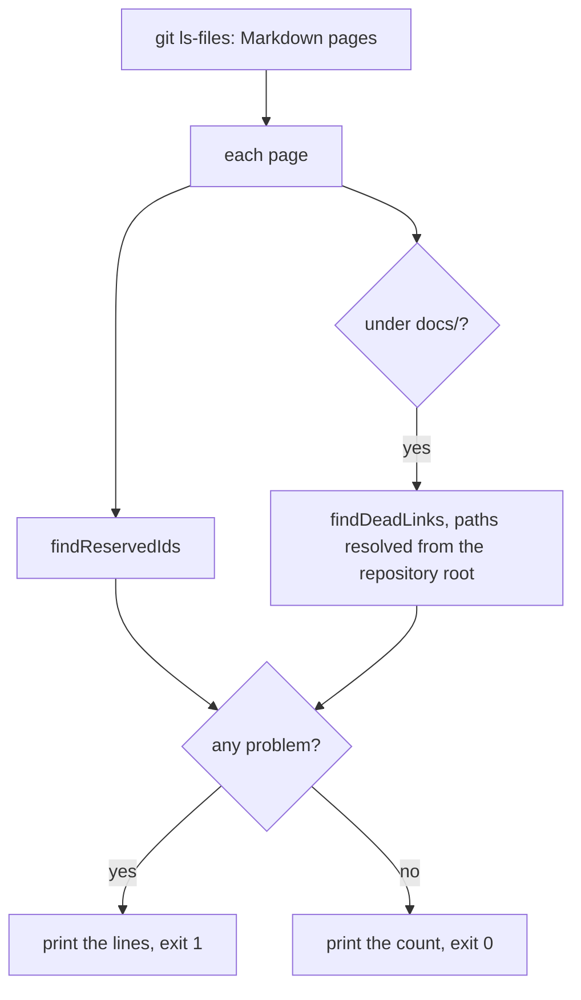

# check-docs.mjs

## What it does

The `check:docs` script of the root `package.json`: lists the tracked and untracked-but-not-ignored
Markdown files (`git ls-files --cached --others --exclude-standard`), runs `findReservedIds` over every
one and `findDeadLinks` over those under `docs/`, prints one line for each problem and exits 1, or
prints a count and exits 0.

## Why it exists

A reserved node id breaks a sidecar graph and a renamed heading kills the links to it. The decisions are
in `docs-check.mjs` (see `docs-check.md`), which has the tests; this file only reads files and joins
paths, so it has none. `.husky/pre-commit` and the lint job of `.github/workflows/ci.yml` run it.

## The logic

## Limits

- It has no test file: the logic worth testing is in `docs-check.mjs`.
- Only `docs/` is checked for links; sidecars and package pages are checked for graphs only.
