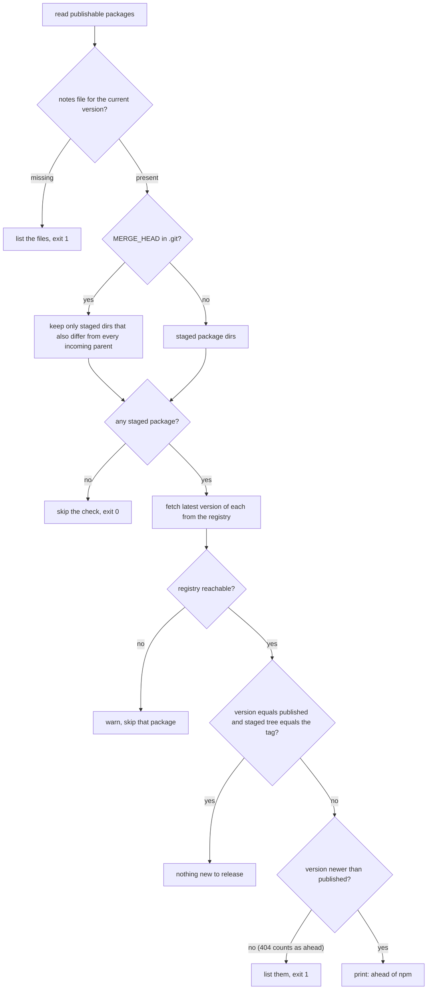

# check-release-notes.mjs

## What it does

Runs two guards over the publishable packages (every folder of `packages/` whose `package.json` is not
`private`). Guard 1: each has `packages/<dir>/release-notes/<version>.md` for its current version. Guard 2:
a package with staged changes is ahead of the latest version on npm. It exits 1 on a failure of either
and 0 otherwise.

## Why it exists

`.github/workflows/cd-packages.yml` reads the release notes at publish time and refuses to release
without them. Guard 1 finds the gap at commit time, so a version bump cannot land on `main` without its
notes. Guard 2 stops the opposite mistake, editing a package and forgetting the bump. It is the
`check:release-notes` script of the root `package.json`, run by `.husky/pre-commit` and by the lint job
of `.github/workflows/ci.yml`. `docs/releasing.md` describes the release flow it protects.

## The logic

`compareVersions` compares the numeric cores first; with equal cores a release is newer than its
prereleases (0.1.0 is ahead of 0.1.0-alpha.0), and two prereleases are equal. A package never published
(`404`) is ahead by definition and is not listed as stale. `matchesRelease` runs
`git diff --cached --quiet <name>@<version> -- packages/<dir>`: exit 0 means the staged package is
exactly the release, which is what undoing an unreleased bump produces.

## What it guarantees

- Private packages are never checked.
- A package with no staged change is skipped, so resting at the published version is fine and several
  commits against one unreleased version pass.
- Being offline never blocks a commit: an unreachable registry (timeout of 5000 ms, a non-OK answer other
  than 404) is a warning.
- During a merge, a package that came in unchanged from a parent is not blamed for a missing bump; an edit
  made during conflict resolution is still checked.
- It changes nothing in the repository.

## Decisions

- The registry is read with `fetch`, not the `npm` binary.
- MERGE_HEAD is read from `.git` on disk, not asked of git: one process fewer, and the path is fixed for
  a regular checkout (the comment's reasoning).
- A tag this clone lacks counts as a difference, so the check still runs.

## Limits

- It assumes `.git` is a directory; a worktree or submodule checkout has no `.git/MERGE_HEAD` at that
  path, so a merge there is not recognised.
- Two prereleases of one core compare equal, so a bump from `1.0.0-alpha.1` to `1.0.0-alpha.2` counts as
  not ahead.
- It has no test file.
