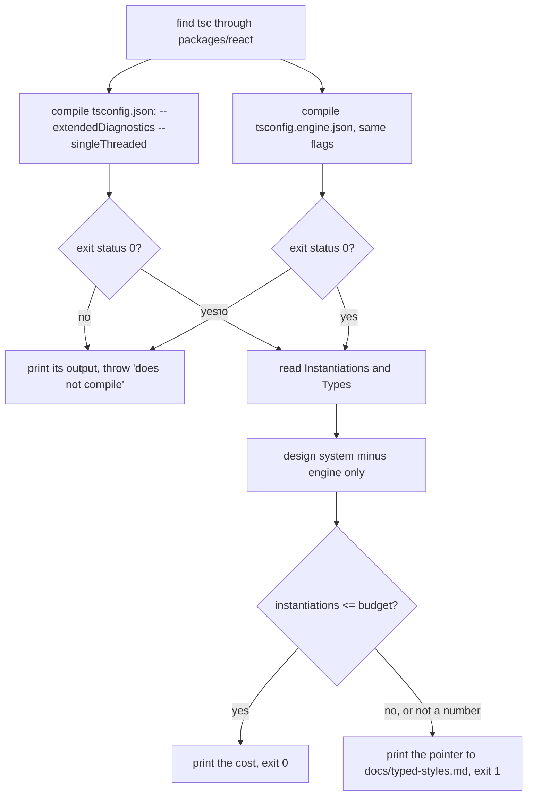

# check-type-cost.mjs

## What it does

Compiles two TypeScript programs of `packages/react/type-cost/` with the TypeScript of
`@umber-style/react`, reads the number of instantiations and types from `--extendedDiagnostics`, and
fails when the difference between them is over `INSTANTIATION_BUDGET` (164,000). The first program is a
design system (`tsconfig.json`, which holds `designSystem.tsx`); the second (`tsconfig.engine.json`,
`engineOnly.ts`) imports the same modules of the engine and does nothing with them.

## Why it exists

The types of the React binding can grow expensive for the checker as shapes get deeper. A count of
instantiations is the same on every run for one version of TypeScript and of `@types/react`, where a time
is not, so it can be a gate. The typecheck script of `packages/react` ends with it. The page
`docs/typed-styles.md` ("How the cost of the types is kept") explains the cost and the budget.

## The logic

The comparison is written `!(instantiations <= budget)`, so a count that could not be read (`NaN`) fails
too.

## The data

- `INSTANTIATION_BUDGET = 164_000`: about 20 percent over the 136,522 that TypeScript 7.0.2 with
  `@types/react` 19.3.0 counts. The form of the props before it counted 175,941. The comment says to set
  it again, the same way, when either is upgraded.

## What it guarantees

- A single-threaded compile: with several checkers a type two files need is counted once in each and the
  split of files moves the total.
- The engine's own source is subtracted, so the number is the cost of the design system's shapes.
- Output of a failed compile is printed before the error is thrown.

## Decisions

- Instantiations are the budget, not time or memory.
- The budget is a number set by hand with a margin, not computed.

## Limits

- It measures one fixture; a shape the fixture lacks is not measured (`docs/typed-styles.md` says so).
- A new TypeScript or `@types/react` version changes the count and needs the budget set again.
- It has no test file.
