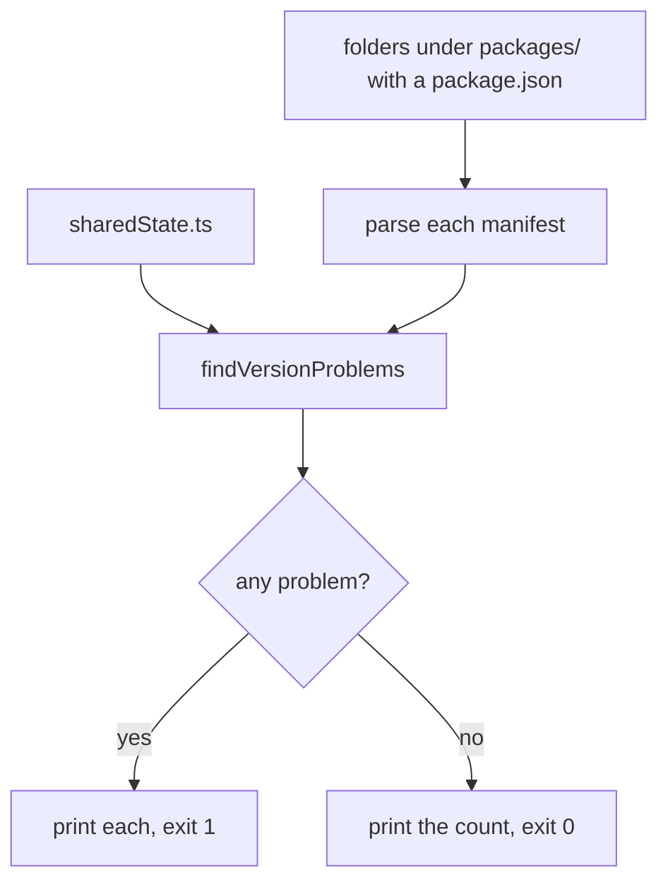

# check-versions.mjs

## What it does

The `check:versions` script of the root `package.json`: reads the `package.json` of every folder under
`packages/`, and the text of `packages/core/src/sharedState.ts`, runs `findVersionProblems` over them,
prints one line for each problem and exits 1, or prints a count and exits 0.

## Why it exists

Nothing checked that the family carries one version, that `CORE_VERSION` names it, or that siblings are
declared as `workspace:^`. The decisions are in `versions-check.mjs`; this file is the reading and the
printing. It runs in `.husky/pre-commit`, in the lint job of `.github/workflows/ci.yml`, and in
`.github/workflows/cd-packages.yml` before the versions of the run are written, so a release cannot
start from a tree whose versions differ.

## The logic

## Decisions

- It runs before `prerelease-versions.mjs` in the release workflow: that script rewrites the versions
  of the checkout into the channel's prerelease, which this check would refuse.

## Limits

- It is not tested on its own: it only reads and prints, and every decision is covered through
  `versions-check.test.mjs`.
