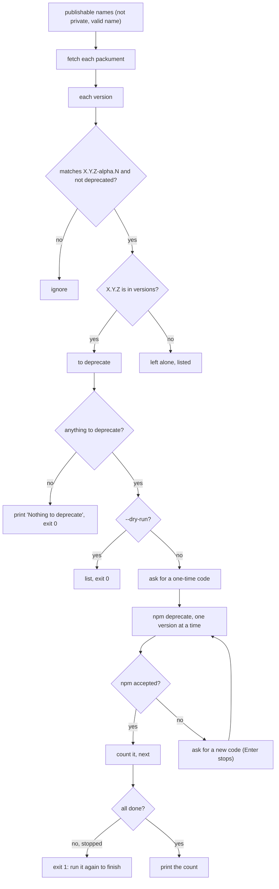

# deprecate-alpha.mjs

## What it does

For every publishable package it reads the registry document, finds each version `X.Y.Z-alpha.N` whose
`X.Y.Z` is on npm and that is not already deprecated, and deprecates it with the message
`Prerelease - use <name>@^X.Y.Z` through `npm deprecate`, asking for npm's one-time code. An alpha whose
release is not on npm yet is left alone and listed. `--dry-run` lists and stops.

## Why it exists

After a stable release the alphas are noise on npm: this points each at its release. It is the
`deprecate-alpha` script of the root `package.json` (`pnpm deprecate-alpha`), run by hand after a stable
release. `docs/releasing.md` describes it. It never touches an rc, nor a `0.0.0-stage`, because only the
`alpha` pattern matches.

## The logic

## What it guarantees

- Only a name that matches `NAME`, a version that matches `ALPHA` and a code that matches `OTP`
  (6 to 8 digits) reach the shell.
- A second run picks up what the first left: a deprecated version is skipped.
- A package never published (404) has nothing to do; any other registry error throws.
- With `--dry-run` nothing is changed and no prompt is made.

## Decisions

- The command goes through a shell so npm is found on every platform; the values are validated first.
- A code lasts about 30 seconds, so a refusal asks for a new one instead of failing.

## Limits

- A refusal for any reason other than an expired code is reported as such ("the code may have expired").
- It has no test file; it needs the network and an npm login.
