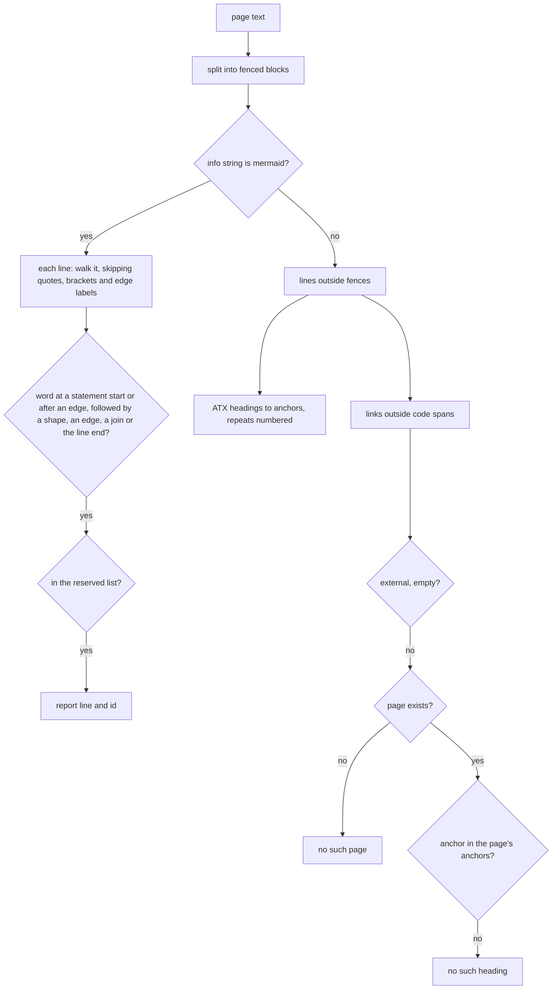

# docs-check.mjs

## What it does

The pure part of `check-docs.mjs` (`pnpm check:docs`): text in, problem lines out, no file or process
access. Two checks over the Markdown of the repository:

- `findReservedIds(text)`: the node ids of each `mermaid` graph that are a reserved word of the graph
  syntax (`style`, `call`, `class`, `default`, `end`, `click`, `graph`), with their line.
- `findDeadLinks(file, text, { resolve, readPage })`: the links of a page that point at a page that is not
  there, or at a heading the page has no anchor for.

## Why it exists

A parser reads a reserved word used as a node id as a keyword, and the graph stops parsing (fifteen
sidecars had `call`). A heading that is renamed leaves the links to its anchor dead, and nothing breaks
until a reader clicks. Both are cheap to find from text, so the pre-commit hook and the CI lint job do
it. `docs-check.test.mjs` tests it at 100% (`pnpm test:scripts`).

## The logic

## Decisions

- A small reader, not a regular expression: a pattern over a graph line can backtrack on text that
  nearly matches, and the lines hold quoted labels with every punctuation mark in them.
- A word is an id only when a shape, an edge, a join (`&`, `;`, `:::`) follows it, or, after an edge, the
  end of the line. That is what lets `end` close a subgraph and `style a fill:...` stand.
- The anchor follows GitHub: links in a heading reduced to their text, lower case, characters other than
  letters, digits, `_`, `-` and space removed, spaces to hyphens, a repeat numbered `-1`, `-2`.
- The CLI passes `resolve` and `readPage`, so the tests need no file.

## Limits

- Only the first word-like token of a statement is read: a graph that is not a flowchart (a sequence or
  state diagram) is read the same way and may give a false report or miss an id.
- It is not a parser: a graph with a syntax error that uses no reserved id passes. Reserved words are
  compared as written, in lower case.
- An id after an edge written `-- text -->` is read when the text is a word followed by an edge.
- Links: only `[label](target)` in ATX-heading pages. Reference links (`[a]: url`), HTML anchors,
  setext headings, headings with inline HTML or emphasis marks other than punctuation, and a `)` inside a
  target are not read. A target that is not Markdown is checked for existing only; external links are not
  fetched.
