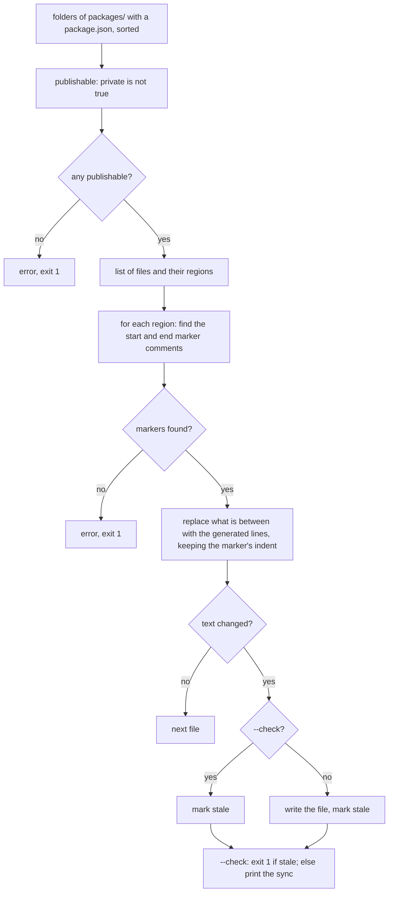

# gen-publish-options.mjs

## What it does

Rewrites the parts of config that list the packages, from the folders under `packages/`: the `package`
choice list of `.github/workflows/cd-packages.yml`, the flag, patch-flag and component entries of
`.codecov.yml`, the "Affected area" dropdown of each of the seven issue forms in
`.github/ISSUE_TEMPLATE/`, and the area allowlist of `.github/workflows/label-area.yml`. With `--check` it
writes nothing and exits 1 when a file would change.

## Why it exists

A new package must appear in all of those places, and a hand edit is forgotten. The root
`package.json` script `gen:publish-options` runs it; `.husky/pre-commit` and the lint job of
`.github/workflows/ci.yml` run it with `--check`, so a committed config cannot drift from the folders.

## The logic

## The data

- A region is a pair of marker comments such as `# gen:publish-options start` and
  `# gen:publish-options end`; the start line gets the note "regenerated by `pnpm gen:publish-options`; do
  not edit by hand".
- The publish workflow lists the non-private packages after `all` (a mode: the workflow expands it to
  every non-private package whose version is not on npm). Every other file lists every folder, private or
  not.
- The label-area list has plain names; the others have a `- ` prefix.

## What it guarantees

- Text outside the markers is never touched, so hand-written siblings (`web`, `e2e`, `api` flags) are
  kept.
- It is idempotent: a second run reports "already up to date".
- It refuses to emit an empty list.

## Decisions

- Markers instead of whole-file generation, so the files stay hand-editable around the generated block.
- Regions are found with a regular expression built from the escaped marker text.

## Limits

- A missing marker is a hard failure, not a silent skip.
- It has no test file.
