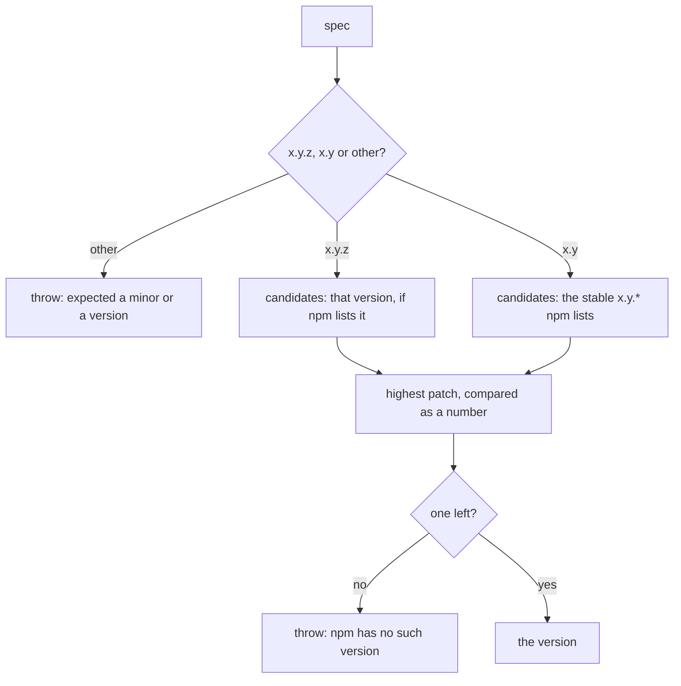

# next-pin.mjs

## What it does

The pure part of `use-next.mjs`, with no file, network or process access:

- `pickNextVersion(spec, versions)`: the version a minor (`16.3`) or an exact version (`16.3.8`) names
  among the versions npm lists for `next`.
- `pinNext(manifest, version)`: the root manifest with `pnpm.overrides.next`.
- `readPinnedNext(manifest)`: the version a manifest pins `next` to.
- `findUnpinnedNext(installed, version)`: one line for each installed copy of another version.

## Why it exists

`use-next.mjs` writes a file, reads the registry and spawns `pnpm`; the decisions it makes are here so
that `next-pin.test.mjs` can test them at 100% without any of those (`pnpm test:scripts`). It is
`react-pin.mjs` for one package instead of two.

## The data

- A version list is the keys of the `versions` of the registry document of `next`: stable versions
  (`16.3.8`) and prereleases (`16.5.0-canary.69`, `16.5.0-preview.0`).
- The root manifest is the parsed `package.json`; only its `pnpm` field is read or written.
- An installed copy is `{ member, version }`: the workspace member's package name and the version of
  `next` it resolves.

## The logic

## What it guarantees

- A minor never picks a prerelease, and `16.0.11` is newer than `16.0.9`.
- `pinNext` returns a new object and keeps every other field and override, a React pin included.
- `findUnpinnedNext` reports an empty list of copies as a problem, so a check cannot pass on nothing.

## Limits

- It knows the form of a version and nothing of the Next.js release lines: any `x.y` is accepted, and a
  minor that npm does not have is refused only by `pickNextVersion` finding no version.
- Only `next` is pinned. Before 16.3 Next.js cannot build the App Router fixture with the workspace's
  TypeScript 7 (16.0.11 and 16.1.7 fail to load `next.config.ts`, 16.2.12 refuses the compiler for its
  type check), so a pin of 16.0 to 16.2 builds nothing until the fixture's TypeScript is pinned below 7 by
  hand (`"@umber-fixtures/next-app>typescript": "^6.0.0"` in the same overrides).
