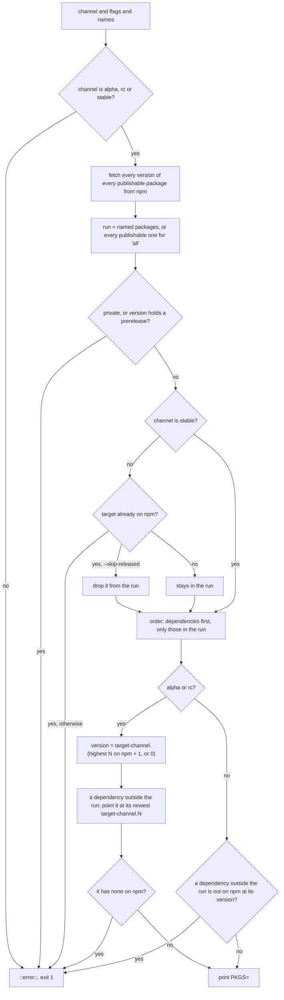

# prerelease-versions.mjs

## What it does

`node scripts/prerelease-versions.mjs <alpha|rc|stable> [--skip-released] [--dry-run] <dir|all>...` turns
the packages of one release run into the versions it publishes, in the CI checkout only, and prints
`PKGS=<dirs>` (dependencies first) for `$GITHUB_ENV`. On `alpha` and `rc` it rewrites each package's
`package.json` version to `<target>-<channel>.N` and points workspace dependencies outside the run at
their newest prerelease. On `stable` it keeps the versions and only orders the packages.

## Why it exists

A `package.json` always holds the target version (`2.0.0`), never a prerelease; nobody edits it for an
alpha. `.github/workflows/cd-packages.yml` calls this script before the build and the smoke test, then
publishes `$PKGS` in order. Nothing is committed. `docs/releasing.md` describes the channels.

## The logic

A dependency outside the run whose target is already released keeps its version. The dependencies read are
`dependencies` and `peerDependencies` whose spec starts with `workspace:`; `devDependencies` never reach a
consumer.

## What it guarantees

- A prerelease can never reach `latest` by being published as it is: a `package.json` holding one is
  refused on every channel.
- N is one above the highest on npm for that target and channel, so a rerun does not repeat a version.
- Order puts a dependency before its dependents, so a dependent never points at a version not yet on npm.
- With `--dry-run` it prints what would be published (`name: old -> new` on stderr) and writes no file.
- Only `PKGS=...` goes to stdout, so `>> "$GITHUB_ENV"` is safe; the messages go to stderr.

## Decisions

- Versions are read from the registry with `fetch`, as `check-release-notes.mjs` does, so no `npm` binary
  is looked up on `PATH`.
- `all` is every publishable package, and with it a package already released is skipped rather than an
  error (`--skip-released`).

## Limits

- A registry answer other than 200 or 404 fails the run.
- It has no test file; the doc `docs/releasing.md` lists `--dry-run` as one of the checks made before the
  workflow ever ran.
