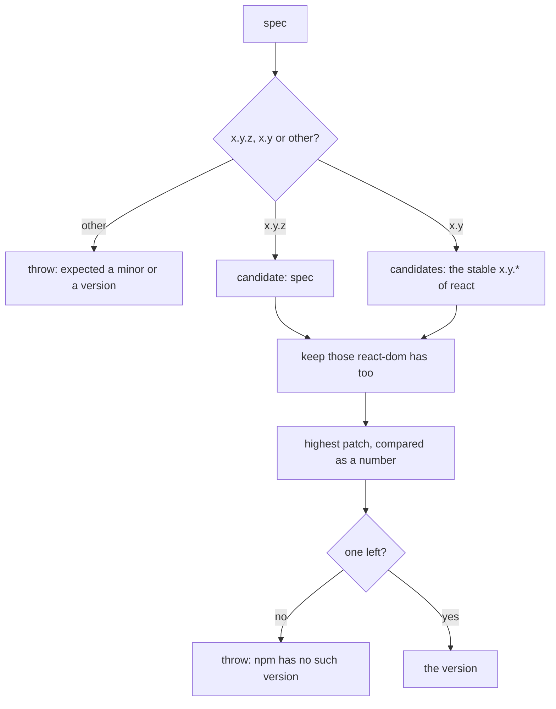

# react-pin.mjs

## What it does

The pure part of `use-react.mjs`, with no file, network or process access:

- `pickReactVersion(spec, reactVersions, reactDomVersions)`: the version a minor (`19.0`) or an exact
  version (`19.0.9`) names among the versions npm lists for both packages.
- `pinReact(manifest, version)`: the root manifest with `pnpm.overrides` for `react` and `react-dom`.
- `readPinnedReact(manifest)`: the version a manifest pins both packages to.
- `findUnpinned(installed, version)`: one line for each installed copy of another version.

## Why it exists

`use-react.mjs` writes a file, reads the registry and spawns `pnpm`; the decisions it makes are here so
that `react-pin.test.mjs` can test them at 100% without any of those (`pnpm test:scripts`).

## The data

- A version list is the keys of the `versions` of a package's registry document: stable versions
  (`19.0.9`) and prereleases (`19.2.0-canary-...`).
- The root manifest is the parsed `package.json`; only its `pnpm` field is read or written.
- An installed copy is `{ member, name, version }`: the workspace member's package name, `react` or
  `react-dom`, and the version that member resolves.

## The logic

## What it guarantees

- A minor never picks a prerelease, and `19.0.10` is newer than `19.0.9`.
- `pinReact` returns a new object and keeps every other field and override.
- `readPinnedReact` refuses a manifest whose two pins differ.
- `findUnpinned` reports an empty list of copies as a problem, so a check cannot pass on nothing.

## Decisions

- Patches are compared as numbers within one minor; the major and minor are fixed by the spec.

## Limits

- It knows the form of a version and nothing of the React release lines: any `x.y` is accepted, and a
  minor that npm does not have is refused only by `pickReactVersion` finding no version.
