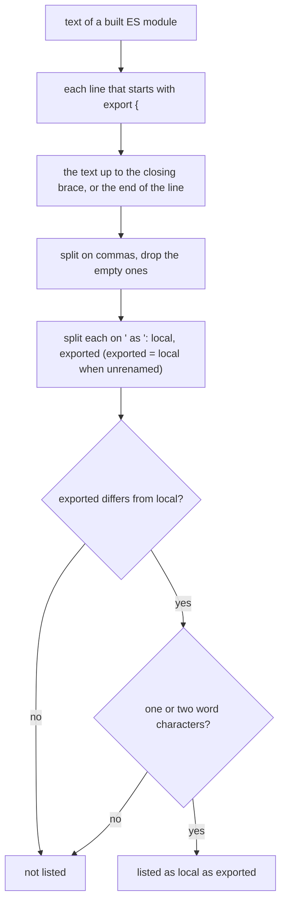

# shared-exports.mjs

## What it does

The pure part of the shared-chunk check of `smoke-packed.mjs`, with no file access:

- `readExportSpecifiers(source)`: the specifiers of every `export { ... }` statement that starts a line
  of a built ES module, as `{ local, exported }`.
- `findMinifiedExports(source)`: the specifiers that export a name under a minified one, written as
  `local as exported` (`globalStyles as D`); empty when there is none.

## Why it exists

A package built from several entries puts the code they share in a chunk of its own. By default the
bundler exports that code under minified names (`export { D as globalStyles }` in the chunk is
`globalStyles as D`), and each entry imports it back renamed. Turbopack adds a module for each
renamed name a binding imports, and with the core of 0.8.0 that pushed the chunk of the React
binding past the size at which Next.js merges chunks: a page loaded one more script than on 0.7.0
([#84](https://github.com/soroush-tech/umber-style/issues/84)). The packages with shared code now
build with `minifyInternalExports: false`; this check fails `pnpm smoke:packed` when a shared chunk
is renamed again, by a new package, a new entry or a change of the bundler's default.
`shared-exports.test.mjs` tests it at 100% (`pnpm test:scripts`).

## The data

- `source` is the text of a built `.mjs` file. The bundler writes its export statement on one line
  that starts with `export {`, at the end of the file; a comment that mentions an export clause does
  not start a line with it.
- A minified name is one or two word characters (`t`, `D`, `Ct`, `$`): the names the bundler gives.
  A public name is longer, so a rename to one (`isPropValid as default`, the React Native binding's
  `Appearance as platformAppearance` re-exported from `react-native`) is not listed.

## The logic

## Decisions

- The check runs on the files no export of the packed `package.json` points at (`smoke-packed.mjs`
  chooses them): an entry's export names are its public API, and one of two characters (`at`) is
  public.
- A rename to a full name passes: an unbundled binding re-exports a dependency's value under a name
  of its own, which no bundler adds a module for in the way #84 measured.
- The pattern of a minified name is anchored and bounded (`^[\w$]{1,2}$`), and the statement is cut
  with `indexOf`, so nothing in it can backtrack.

## Limits

- It reads export statements written on one line, as the bundler writes them; one broken over
  several lines is read up to the end of its first line.
- It reads the ES module builds only. The CommonJS builds define each export by its own name
  (`Object.defineProperty(exports, "createPropFilter", ...)`) with or without the option, and are
  not checked.
- A name of three characters or more given by the bundler (a chunk of thousands of exports) would
  not be found.
