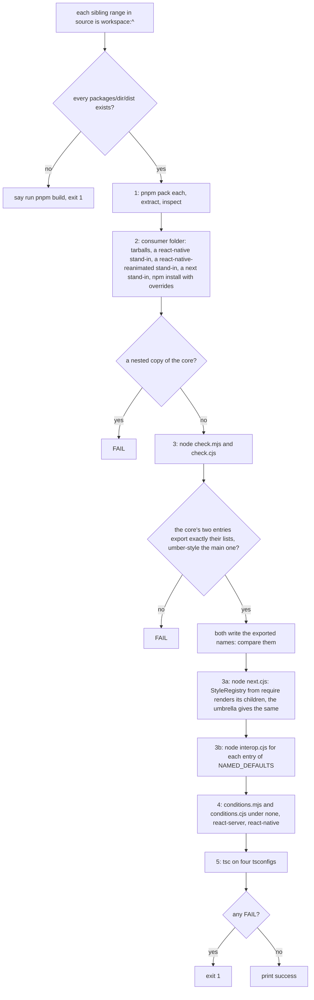

# smoke-packed.mjs

## What it does

Packs each publishable package with `pnpm pack`, inspects every tarball, installs all of them together
into a temporary folder outside the workspace with npm, and checks from there that the packages work as
npm hands them out. It checks the contents of the tarballs, that every entry loads with `import` and with
`require` and gives the same names, that an entry with a default export has the same function by name and
that a CommonJS file that loads it as a bundler's Node interop does gets the function by that name, a
server render of a styled component, the animated entry of React Native (over a stand-in of the animation
library: the entry and its subpath of the umbrella are one value, and it translates a shorthand), the
Next.js registry entry of React (`@umber-style/react/next`, over a stand-in of `next`: the entry and its
subpath of the umbrella, `umber-style/react/next`, are one component), the export
conditions, and that TypeScript resolves the declarations. It prints `ok` or `FAIL` for each check, exits 1 if any failed, and
removes the folder unless `--keep` is given.

## Why it exists

In the workspace, packages consume source and `publishConfig` swaps in `dist` only when a tarball is made,
so a broken `exports` map, a missing file or a leftover `workspace:` range shows only after publishing.
This script finds it first. It is the `smoke:packed` script of the root `package.json` (`pnpm build &&
node scripts/smoke-packed.mjs`), run by the `build` job of `.github/workflows/ci.yml` and, before
anything reaches npm, by `.github/workflows/cd-packages.yml` after `scripts/prerelease-versions.mjs`
(a failure there publishes nothing). `docs/releasing.md` ("The packed-tarball test") describes it.

## The logic

Step 1 checks each tarball: not private; `exports`, `main`, `module` and `types` all start with `./dist/`
and exist (a package with no `.` entry, `is-prop-valid`, has no main, module or types to check); no
`/src/` in the manifest; `LICENSE` and `README.md` present; no `workspace:` left; each sibling published
as `^<its version>`; nothing but `dist`, `LICENSE`, `README.md`, `package.json`; and no `.mjs` file under
`dist` that no export, `main` or `module` points at (a chunk the entries share, or a module of an
unbundled build) exporting a name renamed to a minified one (`findMinifiedExports` of
`shared-exports.mjs`, #84). Step 3 loads every key of
`ENTRIES` and also checks that each entry of `NAMED_DEFAULTS` exports its default by name, the same
function, that the bindings and the umbrella hand out the very functions of one core,
that each prop filter answers for its platform, that `@umber-style/is-prop-valid` has no root entry, that
`css` writes its rule into its cache, that a styled React component renders to a class with its CSS and no
`style=`, and that `@umber-style/server` puts `<style data-umber>` elements first. Step 3b runs
`interop.cjs` once for each entry of `NAMED_DEFAULTS`: it loads the entry as the helper of a bundler does
for an ES module package's CommonJS build (`__toESM(require(id), 1)`: the default is the whole
`module.exports`, the other exports read through by name), asserts that the default it gets is not a
function, calls the function by its name (renders a styled `div`, makes a cache, puts a page's tags in
front of it, makes a class, answers for a prop of the platform) and checks the answer. Step 4 runs the
condition scripts with `--conditions=react-server` and `--conditions=react-native`. Step 5 compiles
`entries.ts`, `entries.mts` and `entries.cts` (bundler, node16), `library.cts` (node16: a CommonJS file
that imports the default exports by name), `server.ts` (custom condition
`react-server`), `strict.ts` (the strict switch of `StyleTypeOptions`) and `next.ts` (bundler: the props
of `StyleRegistry` with a cache of `@umber-style/cache`, from the entry and from the umbrella) with
`skipLibCheck` off. Step 3a requires `@umber-style/react/next`, renders `StyleRegistry` on the server over
the stand-in of `next`, and requires `umber-style/react/next` for the same component; neither is
imported from an ES module, which Node cannot do for `next/navigation` (the package has no exports map).

## The data

- `PACKAGES`: dir and name, in publish order (core, cache, server, css, is-prop-valid, react, styled,
  react-native, vue, umber-style).
- `ENTRIES`: specifier -> the names that entry must export (`'@umber-style/react': ['createStyle',
  'styled', ...]`, `'@umber-style/css/create-instance': []`). For the two entries of the core the names
  are the full lists, `CORE_EXPORTS` (what apps use) and `CORE_INTERNAL_EXPORTS` (what the family
  shares): step 3 fails when either exports a name more, and when the root of `umber-style` exports
  other names than `@umber-style/core`. Step 5 imports from the internal entry a helper and a type, and
  expects an error for each from the main entry.
- `NAMED_DEFAULTS`: specifier -> the name its default export also has (`'@umber-style/cache':
  'createCache'`): `styled`, `cache`, the two `create-instance` subpaths and the three subpaths of
  `is-prop-valid`.
- The stand-in `react-native`: a small package of five values (`Appearance`, `StyleSheet`, `Dimensions`,
  `AccessibilityInfo`, and a `Pressable` that renders nothing, which the binding compares a component
  with) and their types. A value the binding imports that the stand-in lacks fails the ESM checks
  (`does not provide an export named`).
- The consumer's `overrides` map each package name to `$<name>`, so the tarballs, which name each other
  with versions npm does not hold yet, resolve to the files.

## What it guarantees

- It tests what npm would hand out: the packed tarball, installed in a folder with no link to the
  workspace.
- The ESM and the CJS builds export the same names and render the same HTML.
- A library whose CommonJS build reaches an entry through the Node interop gets the function by name.
  The interop gives the whole `module.exports` as the default, an object, for as long as the CommonJS
  files keep `{ __esModule: true, default }` (`cjsDefault: false`); step 3b fails if a default becomes a
  function that way, because that is a change of what every existing `require` gets, to be made on
  purpose and said in the release notes.
- Output of a command is shown only when it fails.
- On Windows `npm`, `npx` and `pnpm` are started through a shell; the arguments are quoted with
  `JSON.stringify`.
- The temporary folder is removed in `finally`, also after an exception.

## Decisions

- A stand-in for `react-native`, because Node cannot load the real one; the real types are covered by the
  workspace typecheck.
- Relative paths for `tar`: a drive letter in an argument makes GNU tar look for a remote host.
- `workspace:^` for siblings is checked in the source: an exact version would nest a second copy of a
  sibling under a package when that sibling is released alone.
- Versions of `react`, `react-dom`, `vue`, `typescript` and the types are read from the devDependencies of
  the workspace packages, so the consumer uses the same ones.

- The interop of step 3b is written out in the script rather than produced by a bundler, so the
  consumer installs no bundler; it is the Node mode of the helper, the one a `"type": "module"` package
  gets.

## Limits

- It needs the network (npm install) and a prior `pnpm build`.
- The React Native binding runs only against the stand-in, and the animated entry only against a stand-in of
  the animation library with its four functions: what the library does with the style is not checked here.
- It has no test file.
- `tarballs` are matched to a package by "the first `.tgz` not yet used", which relies on `pnpm pack`
  writing one new file per call.
