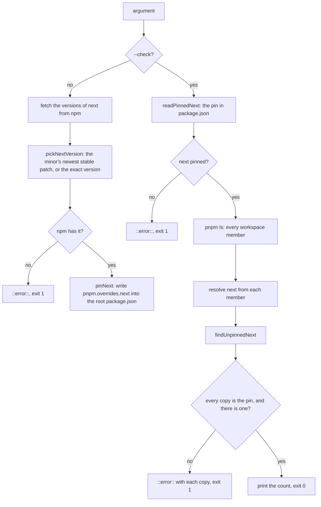

# use-next.mjs

## What it does

`node scripts/use-next.mjs <16.N | 16.N.M>` pins `next` across the whole workspace to one version: it asks
the npm registry for the versions of `next`, picks the version the argument names (`pickNextVersion` of
`next-pin.mjs`: a minor is its newest stable patch, an exact version is itself), and writes it into the
root `package.json` as `pnpm.overrides.next`. The install that follows must be
`pnpm install --no-frozen-lockfile`, because the lockfile names another Next.js.

`node scripts/use-next.mjs --check`, after that install, reads the pin back from `package.json`, lists the
workspace members with `pnpm ls -r --depth -1 --json`, resolves `next/package.json` from each member, and
fails when a copy is another version or when no member resolves it.

Exit code 0 on success; 1 with an `::error::` line otherwise.

## Why it exists

`@umber-style/react/next` declares `next` as an optional peer over a range of Next.js 16 releases, and the
range is what CI runs: the App Router fixture on the lowest minor of the range and on the newest
(`docs/testing.md`). `.github/actions/setup` runs this script when a job gives a `next` input (the Next.js
axis of `.github/workflows/ci.yml`): the pin, the install, then the check. A machine runs the same three
commands to reproduce a row, and undoes them with `git checkout package.json pnpm-lock.yaml` and
`pnpm install --frozen-lockfile`. It is `use-react.mjs` for `next`.

## The logic

## What it guarantees

- Every other field of `package.json`, other `pnpm` settings and other overrides (a React pin) included,
  is kept, so a row can pin React and Next.js together.
- `--check` never passes on nothing: a workspace where no member resolves `next` fails.
- The script changes only the root `package.json`; the install changes the lockfile. Neither is meant to
  be committed.

## Decisions

- A separate script, not a flag of `use-react.mjs`: React is pinned as two packages that must agree, Next.js
  as one, and each axis gives its own input to the setup action.
- A root override reaches every member that depends on `next`: the App Router fixture, the Pages Router
  fixture and the React binding's dev dependency. Only the App Router fixture's rows pin it in CI.
- CI gives a minor and the newest patch is resolved when the job runs, as for React: a new patch can turn a
  row red on a pull request that changed nothing; the job log and the check print the exact version.

## Limits

- The React that the App Router renders is the one Next.js bundles (`next/dist/compiled/react`), so a pin
  of Next.js changes the React of that fixture too: 16.3.8 bundles `19.3.0-canary-cbb046ab-20260731`,
  16.4.6 `19.3.0-canary-278794d7-20261002`.
- This file has no test of its own; its network, file and process calls run in CI's Next.js rows. The
  pure logic is in `next-pin.mjs`, tested by `next-pin.test.mjs` (`pnpm test:scripts`).
