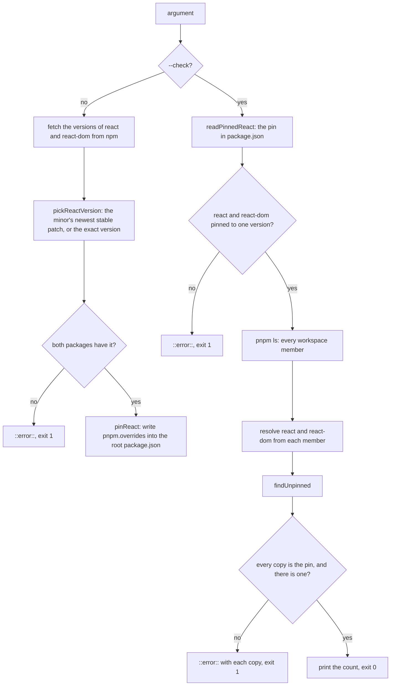

# use-react.mjs

## What it does

`node scripts/use-react.mjs <19.N | 19.N.M>` pins `react` and `react-dom` across the whole workspace to
one version: it asks the npm registry for the versions of both packages, picks the version the argument
names (`pickReactVersion` of `react-pin.mjs`: a minor is its newest stable patch, an exact version is
itself), and writes it into the root `package.json` as `pnpm.overrides` for both packages. The install
that follows must be `pnpm install --no-frozen-lockfile`, because the lockfile names another React.

`node scripts/use-react.mjs --check`, after that install, reads the pin back from `package.json`, lists
the workspace members with `pnpm ls -r --depth -1 --json`, resolves `react/package.json` and
`react-dom/package.json` from each member, and fails when a copy is another version or when no member
resolves either.

Exit code 0 on success; 1 with an `::error::` line otherwise.

## Why it exists

The packages declare `react` `^19.0.0`, and the suite has to run on each React 19 minor, not only on the
one the lockfile holds. `.github/actions/setup` runs it when a job gives a `react` input (the React axis
of `.github/workflows/ci.yml`): the pin, the install, then the check. A machine runs the same three
commands to reproduce a row, and undoes them with `git checkout package.json pnpm-lock.yaml` and
`pnpm install --frozen-lockfile`.

## The logic

## What it guarantees

- `react` and `react-dom` are pinned together, to a version npm has for both.
- Every other field of `package.json`, other `pnpm` settings and other overrides included, is kept.
- `--check` never passes on nothing: a workspace where no member resolves React fails.
- The script changes only the root `package.json`; the install changes the lockfile. Neither is meant to
  be committed.

## Decisions

- A root override, not an edit of each member: it reaches every dependent, the transitive ones too (the
  testing libraries, Next.js), and it is one field to undo. It is how the investigation that widened the
  range ran the suite on 19.0.9, 19.1.10, 19.2.0, 19.2.9 and 19.3.1.
- CI gives a minor and the newest patch is resolved when the job runs, rather than a version pinned in a
  file: a minor still gets patches, CI then runs the patch an app on that minor installs today, and no
  list has to be kept up to date. The cost is that a new patch can turn a run red on a pull request that
  changed nothing; the job log and the check print the exact version. An exact version is accepted for a
  machine that reproduces a run.
- The registry is read with `fetch` and the abbreviated document, not the `npm` binary.
- The pure logic is in `react-pin.mjs`, tested by `react-pin.test.mjs` with Node's test runner
  (`pnpm test:scripts`, 100% of lines, branches and functions); this file is the input and output around it.

## Limits

- The App Router fixture runs the React that Next.js bundles (`next/dist/compiled/react`), whatever is
  pinned: the check sees the installed copy, not the bundled one.
- `@types/react` and `@types/react-dom` are not pinned: the types stay those of the lockfile.
- This file has no test of its own; its network, file and process calls run in CI's React rows.
