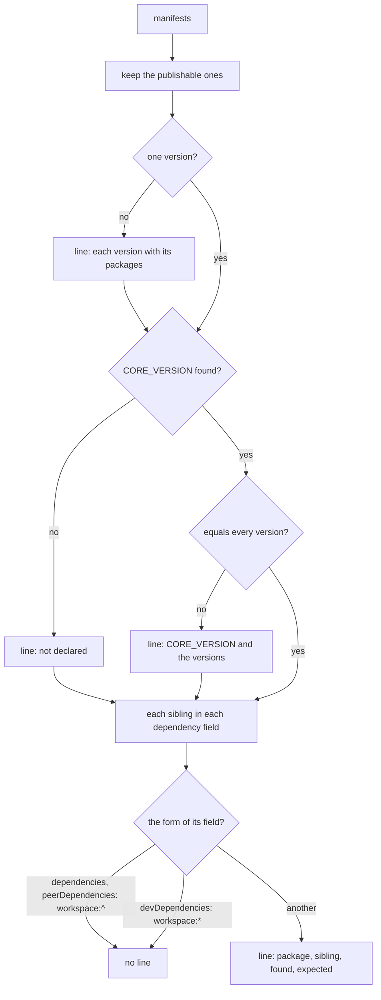

# versions-check.mjs

## What it does

The pure part of `check-versions.mjs`, with no file or process access:

- `readCoreVersion(source)`: the string `CORE_VERSION` is set to in the text of
  `packages/core/src/sharedState.ts`, or `undefined`.
- `selectPublishable(manifests)`: the manifests whose `private` is not true.
- `findVersionProblems(manifests, coreSource)`: one line for each problem of the family, empty when
  there is none.

## Why it exists

The publishable packages carry one version, and `CORE_VERSION` names it, but a package bumped alone or a
forgotten `CORE_VERSION` passed every gate. The decisions are here so that `versions-check.test.mjs` can
test them at 100% without a file (`pnpm test:scripts`); the CLI reads the manifests and prints.

## The data

- A manifest is a parsed `package.json`. The family is every manifest under `packages/` whose `private`
  is not true: the list is never written out, so a new package joins it by existing.
- A sibling is a dependency whose name is the name of a member of the family. A private package
  (`@umber-style/eslint-config`) is not a sibling.

## The logic

## What it guarantees

- A package of another version is named with the versions found and the packages that have each.
- `CORE_VERSION` is compared with every version of the family, so a split family also fails it.
- A sibling in `dependencies` or `peerDependencies` that is not `workspace:^`, or in `devDependencies`
  that is not `workspace:*`, is named with its package and field (AGENTS.md and `packages/packages.md`).

## Decisions

- `CORE_VERSION` is read with `indexOf` between the quotes of its declaration, not a regular
  expression: nothing in it can backtrack.
- The rule for a `devDependency` is checked because AGENTS.md states it as a rule.

## Limits

- It reads the declaration `export const CORE_VERSION = '...'` as written today; another form (a
  double-quoted string, a template) is reported as not declared.
- It does not check `peerDependencies` on packages outside the family, nor the release notes (that is
  `check-release-notes.mjs`).
